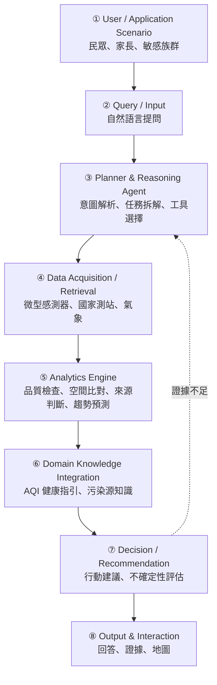

# DESIGN.md — AirSleuth 系統設計文件

> 由總指揮（Claude）維護。依作業規範，這份文件要讓「原開發者不在時，下一位開發者也能理解、執行、驗證並繼續開發」。
> 章節順序照規範：Problem → Requirements → Architecture → Components → Data → AI/Analytics → Domain Knowledge → Algorithm → Implementation → How to Run → Results
> 狀態：**骨架（Proposal 階段逐步填寫）**

## 1. Problem

現有的空品工具（AQI 地圖、App）只告訴民眾「現在數值多少」，不會回答：
- **為什麼**這裡現在特別高？是附近的局部來源，還是整個區域都受影響？
- **我該怎麼做？** 依我的族群（小孩、長者、氣喘患者）和行程，具體該採取什麼行動？
- **這個判斷有多可信？** 低成本感測器的讀數準不準？

（待 T-04、T-06 的證據補強）

## 2. Requirements

### 功能需求
- FR-1：接受自然語言提問，辨識地點、時間、使用者族群、意圖
- FR-2：依問題自動決定要取得哪些資料
- FR-3：整合微型感測器、國家測站、氣象資料
- FR-4：判斷污染比較可能是局部來源或區域傳輸，並說明依據
- FR-5：預測未來數小時的 PM2.5 趨勢
- FR-6：依健康指引產生個人化的行動建議
- FR-7：每項結論都附上證據與不確定性

### 非功能需求
- NFR-1：每項結論都可以追溯到資料來源
- NFR-2：資料取得失敗時要能降級運作，並告知使用者
- NFR-3：低成本感測器的讀數要經過品質檢查

## 3. Architecture

（T-10 會補上完整說明）

## 4. Components

| 編號 | 模組 | 職責 | 實作位置 |
|---|---|---|---|
| ① | User / Application Scenario | 定義使用者與使用情境 | — |
| ② | Query / Input | 接收提問 | `src/agent/` |
| ③ | Planner & Reasoning Agent | 意圖解析、任務拆解、選擇工具、決定是否需要更多證據 | `src/agent/` |
| ④ | Data Acquisition / Retrieval | 串接各資料源 | `src/data/` |
| ⑤ | Analytics Engine | 資料品質檢查、空間比對、來源判斷、預測 | `src/analytics/` |
| ⑥ | Domain Knowledge Integration | 健康指引、污染源知識庫 | `src/knowledge/` |
| ⑦ | Decision / Recommendation | 產生建議、評估不確定性 | `src/agent/` |
| ⑧ | Output & Interaction | 呈現結果與證據 | 待定 |

## 5. Data

見 `AGENTS.md` 第 6 節。（T-07、T-08 完成後補充：欄位、更新頻率、保留期、品質問題）

## 6. AI / Analytics

（T-10、T-11 完成後填寫）

## 7. Domain Knowledge

（T-06、T-09 完成後填寫）

## 8. Algorithm

（T-10：Pseudocode）

## 9. Implementation

（期末階段填寫）

## 10. How to Run

見 [README.md](README.md) 的「開發環境」。

## 11. Results

（期末階段填寫。Proposal 階段只寫 Expected Outcomes，不得捏造結果。）

## 12. Limitations

（待填寫）
