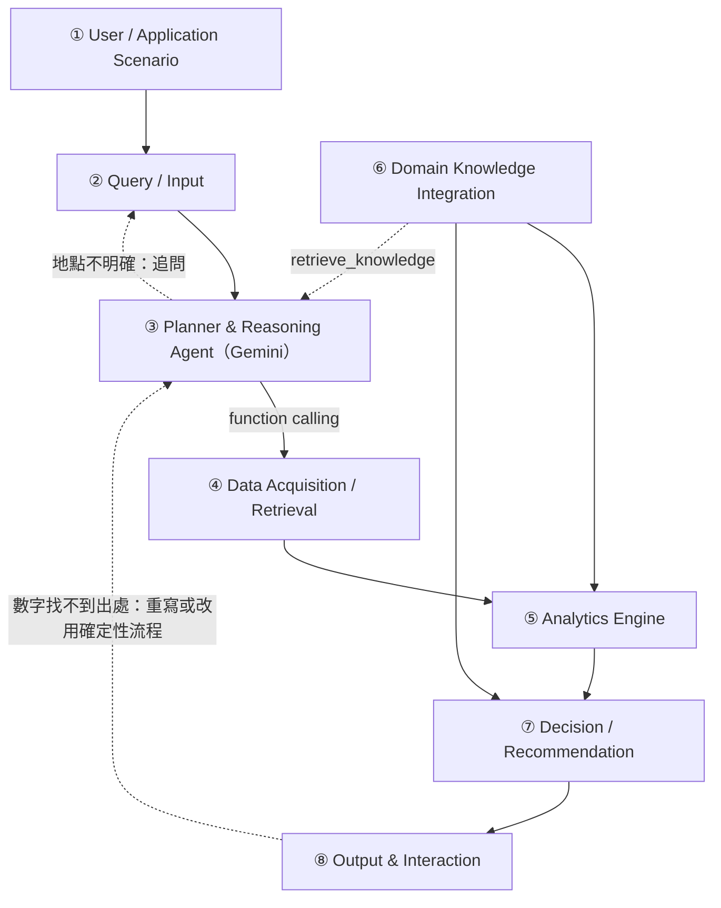

# DESIGN.md — AirSleuth 系統設計文件

> 依作業規範，這份文件要讓「原開發者不在時，下一位開發者也能理解、執行、驗證並繼續開發」。
> 章節順序照規範：Problem → Requirements → Architecture → Components → Data → AI/Analytics → Domain Knowledge → Algorithm → Implementation → How to Run → Results → Limitations
> 狀態：**期末版（2026-11-24）**。可驗證的需求與情境見 [openspec/](openspec/README.md)，實驗見 [experiments/](experiments/README.md)。
> 文中的 `S-xxx` 對應 `research/sources.md`。

## 1. Problem

台灣有約 1.1 萬個公開的微型空品感測器（S-001、S-013），但民眾拿到的仍然只是「數字和顏色」：

- **不知道為什麼**：同樣是 PM2.5 偏高，附近有污染源和整個區域受影響，應對方式完全不同。現有服務不做這個判斷。
- **不知道該怎麼做**：活動建議只依族群分類，沒有結合個人的時間、地點與活動；只給數字時，照警示行動的比例中位數只有 31%（S-028）。
- **不知道該信哪個數字**：微型感測器、國家測站、國外報告的數字都不同（S-022），微型感測器在高濕度時會高估（S-008、S-009）。

## 2. Requirements

### 功能需求

| ID | 需求 | 對應模組 | 實作與驗證 |
|---|---|---|---|
| FR-1 | 接受自然語言提問，辨識地點、時間、使用者族群、活動；不明確就追問 | ②③ | `src/agent/planner.py`、`geo.py`；E4 追問題 |
| FR-2 | 依問題自動決定要呼叫哪些工具 | ③ | Gemini function calling；`tests/test_llm_planner.py` |
| FR-3 | 整合微型感測器、國家測站、氣象資料，並先做品質檢查 | ④ | `src/data/`；`tests/test_quality.py` |
| FR-4 | 判斷升高屬於局部、次區域、區域型或疑似感測器異常，並說明依據 | ⑤ | `src/analytics/spatial.py`；E3 |
| FR-5 | 預測未來 1～6 小時的 PM2.5 趨勢 | ⑤ | `src/analytics/forecast.py`；E1 |
| FR-6 | 依健康指引與使用者情境產生具體、可行動的建議 | ⑥⑦ | `src/knowledge/health.py`；E4 建議一致率 |
| FR-7 | 每項結論附上證據、信心程度、資料來源與工具紀錄 | ⑦⑧ | `pipeline.py`、`app/`；`tests/test_agent.py` |

### 非功能需求

| ID | 需求 | 做法 |
|---|---|---|
| NFR-1 | 回答中的數字都可以追溯到工具結果（防止 LLM 幻覺） | 回答前檢查帶單位的數字；找不到就重寫一次，再不行改用確定性流程 |
| NFR-2 | 資料或 LLM 失敗時降級運作並告知使用者 | 微型感測器不足 → 國家測站；沒有 key、503／429／逾時 → 換模型或確定性流程 |
| NFR-3 | 低成本感測器的讀數先經過品質檢查 | 五種品質旗標；中位數讓單一壞感測器影響不了判斷 |
| NFR-4 | 判斷門檻與健康規則寫成結構化資料，結果可重現 | `spatial.Params`、`health.py` 常數；實驗固定資料期間與亂數種子 |
| NFR-5 | 不關閉 TLS 憑證驗證、不把金鑰寫進紀錄或版控 | `src/data/http.py`；`scripts/collect_scheduled.py::redact` |

## 3. Architecture



- 完整架構圖：`diagrams/architecture.mmd`；流程圖：`diagrams/flowchart.mmd`；論文英文版：`paper/figures/fig1_architecture.png`
- **核心原則**：LLM 只負責理解、規劃與表達；計算、門檻判斷與數字全部由確定性的程式產生，每次工具呼叫都記錄。

**資料流（一次提問）**：

1. 使用者問「我在高雄前金區，可以帶小孩去跑步嗎？」
2. Gemini 呼叫 `resolve_place` → 得到高雄市前金區的座標。
3. Gemini 呼叫 `analyze_air_quality`，內部依序執行 8 個資料工具：
   - 取得微型感測器資料、品質檢查
   - 來源判斷（局部範圍不足會擴大）
   - 取得國家測站、氣象站資料
   - 校正、預測、取出領域知識
   - Algorithm 3 排序，回傳結構化結果
4. Gemini 視需要呼叫 `retrieve_knowledge`，再寫成四段式回答。
5. 數字可追溯檢查通過後回傳，網站顯示回答與工具紀錄。

## 4. Components

| 編號 | 模組 | 職責 | 實作位置 | 狀態 |
|---|---|---|---|---|
| ① | User / Application Scenario | 家長、氣喘患者、運動者、長者照顧者、通勤者 | `app/streamlit_app.py`（示範情境） | ✅ |
| ② | Query / Input | 解析地點（67 個行政區或座標）、時間、族群、活動；不明確就追問 | `src/agent/geo.py`、`planner.py`（含無 LLM 的規則解析） | ✅ |
| ③ | Planner & Reasoning Agent | Gemini function calling（ReAct）、步數上限、數字可追溯檢查、模型備援 | `src/agent/llm.py`、`planner.py` | ✅ |
| ④ | Data Acquisition / Retrieval | 三種資料每小時收集、品質旗標、依查詢時間讀取 | `src/data/`、`scripts/collect_scheduled.py`、`src/agent/tools.py` | ✅ |
| ⑤ | Analytics Engine | 在地校正、空間來源判斷、短期預測（含測站尖峰防護） | `src/analytics/`、`src/agent/tools.py` | ✅ |
| ⑥ | Domain Knowledge Integration | 新版 AQI、敏感族群、運動取捨、暴露量規則與文獻依據 | `src/knowledge/health.py`、`research/` | ✅ |
| ⑦ | Decision / Recommendation | 個人風險等級、候選行動、效益減風險排序、信心程度 | `src/knowledge/health.py`、`src/agent/pipeline.py` | ✅ |
| ⑧ | Output & Interaction | 四段式回答、工具紀錄、網站與命令列 | `app/streamlit_app.py`、`src/agent/ask.py` | ✅ |

## 5. Data

| 資料 | 來源 | 欄位 | 頻率與保留 | 已知問題 |
|---|---|---|---|---|
| 微型感測器 | 民生公共物聯網 SensorThings API（S-001） | station_id、經緯度、PM2.5、濕度、溫度 | 約每 5 分鐘；**API 只保留最近 4～5 小時** | 臺中約 28% 資料列濕度無效（校正改用氣象站濕度）；**2026-11-21 起官方憑證過期**，暫時收不到 |
| 國家空品測站 | 環境部縣市小時值 | PM2.5、PM10、濕度、溫度、風、雨量 | 每小時；可回溯數月 | 臺中 6 站、高雄 12 站，很稀疏 |
| 氣象 | 中央氣象署自動氣象站 `O-A0001-001` | 風向、風速、溫度、濕度 | 只給最新一筆，每小時收集 | 臺中 61 站、高雄 63 站 |
| 本地資料庫 | `data/raw/{colife,moenv,cwa}/<縣市>/YYYY-MM-DD.csv.gz` | 同上 | Windows 排程每小時（到 2027-01-01） | 不進版控 |
| demo 樣本 | `data/sample/demo/`（`scripts/make_demo_sample.py`） | 同上 | 4 個真實事件時間點 | 11 MB，進版控 |

**實驗資料期間（固定）**：
- 微型感測器：10/19～11/18，528 小時，臺中 1,191 個、高雄 1,369 個，共 1,550 萬筆 5 分鐘資料。
- 國家測站：8/20～11/24。

詳見 `docs/analysis/T-25_期末實驗資料集.md`。

**品質旗標**（`src/data/quality.py`）：
- `pm25_missing`：缺值
- `pm25_negative`：負值
- `pm25_extreme`：大於 500
- `stuck`：連續 12 個 5 分鐘區間數值相同
- `rh_invalid`：濕度不在 0–100 之間。這一列的 PM2.5 仍然保留

## 6. AI / Analytics

| 元件 | 方法 | 依據與驗證 |
|---|---|---|
| LLM 規劃器 | Gemini 3.5 Flash-Lite（免費額度）＋function calling；依序備援 3.8 Flash、3.5 Flash | S-035、S-053；E4 |
| 可信度 | 品質旗標、感測器數、濕度、資料新舊 → 信心程度 | S-008、S-009、S-057 |
| 校正 | 分縣市線性＋最近氣象站濕度，以國家測站共置資料擬合 | S-008、S-010、S-058；E2 |
| 來源判斷 | 規則式多尺度空間分類（Algorithm 2） | S-057；E3 |
| 短期預測 | 多元線性迴歸（Agent 使用）；隨機森林、梯度提升樹（Optuna 調參）作比較 | S-048；E1 |

**為什麼來源判斷用規則而不是機器學習**：
- 沒有「局部或區域」的標記資料可以訓練。
- 規則可以解釋，符合「每個結論都附證據」。
- 用半合成注入實驗（E3）檢驗規則的邏輯；累積人工標記事件後，再評估學習式方法。

**為什麼 Agent 用 MLR 而不是較準的樹模型**：
- E1 中梯度提升樹 6 小時 MAE 只比 MLR 低 0.2 μg/m³。
- MLR 每次查詢都只用查詢時間以前的資料即時訓練，係數可以解釋。
- 這是準確度與可解釋性的取捨。

## 7. Domain Knowledge

### 健康指引（2025 年起新版 AQI，PM2.5 24 小時平均，S-016、S-029）

| AQI | 等級 | PM2.5（μg/m³） |
|---|---|---|
| 0–50 | 良好 | 0.0–12.4 |
| 51–100 | 普通 | 12.5–30.4 |
| 101–150 | 對敏感族群不健康 | 30.5–50.4 |
| 151–200 | 對所有族群不健康 | 50.5–125.4 |
| 201–300 | 非常不健康 | 125.5–225.4 |

敏感族群：孩童、長者、氣喘與心血管疾病患者，提前一級提醒（S-032、S-024、S-031）。

### 專家觀念 → 系統設計

| 專家觀念 | 依據 | 在系統中的實作 |
|---|---|---|
| 濃度不等於暴露量 | S-034 | ⑦ 暴露 = 濃度 × 換氣量 × 停留時間；室內濃度約為室外 0.6（假設值） |
| 運動的好處通常大於空污風險 | S-033 | ⑦ 建議調整而不是取消運動 |
| PM2.5 ≥ 25 時運動效益打折 | S-061 | ⑦ 效益乘 0.45；**只對個人風險已達「對敏感族群不健康」以上的人套用**（符合環境部「普通」時一般民眾照常活動，S-032） |
| 敏感族群風險較高 | S-024、S-031 | ⑦ 提前一級 |
| 局部與區域污染的對策不同 | S-057、T-18 爭議 | ⑤⑦ 只有局部或次區域型才建議換地點 |
| 微型感測器看相對、測站看絕對 | S-008、S-022 | ⑤ 在地校正；濕度高時降低信心 |
| 建議要具體可行動 | S-028、S-062 | ⑧ 固定輸出排序後的具體行動 |

## 8. Algorithm

三個演算法（主流程、來源判斷、個人化建議）的虛擬碼見 `proposal/04_proposed_scheme.md` 第 4.4 節；期末實作的修改如下。

**Algorithm 2：來源判斷（`src/analytics/spatial.py`）**

| 參數 | 值 | 說明 |
|---|---|---|
| 局部／次區域／區域半徑 | 2 km／8 km／15 km | 局部範圍可信感測器少於 5 個就擴大到 4、8 km |
| 升高 | 比自己前 6 小時中位數高 50% **且至少 5 μg/m³** | 絕對門檻避免乾淨空氣的小波動被當成升高 |
| 區域型 | C ≥ 0.6 且 E < max(5, 0.3·B) | |
| 次區域型 | 8 km 內至少 5 個感測器、C < 0.6、C_sub ≥ 0.3、C_ring < 0.3 | |
| 局部型 | E ≥ max(10, 0.5·B)、C < 0.3、至少 2 個鄰近感測器一起偏高 | 否則為疑似感測器異常 |
| 混合型 | C ≥ 0.6 且 E 大 | |

**預測套用到查詢點（`src/agent/pipeline.py`）**
- 以測站的預測變化量套用到校正後的局部濃度，變化量限制在目前濃度的 −50%～+100%。
- 測站短暫尖峰時不套用。尖峰的條件是三者同時成立：
  - 比自己前 6 小時中位數高 2 倍以上
  - 比前 6 小時中位數至少高 15
  - 比附近感測器至少高 15

**Algorithm 3：建議排序（`src/knowledge/health.py`）**
- 分數 = 活動效益 − λ(個人風險等級) × 暴露。
- 候選行動：照原計畫、降低強度（散步時改成縮短時間）、延後、換到 8 km 外、改到室內。
- 延後與換地點有兩個限制：
  - 至少要改善 5 μg/m³ 才提出。
  - 計入成本：延後每小時扣 5% 效益，換地點扣 15%。

**用真實資料發現並修正的三個問題**（詳見 `docs/analysis/期末實驗結果.md`）：
1. 測站尖峰被當成預測依據：臺中大里 10/29 18:00 測站 74，附近感測器約 14，原本算出「1 小時後降到 0」。
2. 空氣「良好」時也建議延後 6 小時。
3. 一般民眾在「普通」等級被建議進室內，與環境部指引不一致。

## 9. Implementation Mapping

| 路徑 | 內容 | 對應模組／規格 |
|---|---|---|
| `src/data/colife.py`、`moenv.py`、`cwa.py`、`http.py`、`quality.py` | 三種資料串接、憑證驗證、品質旗標 | ④／`data-acquisition`、`data-quality` |
| `scripts/collect_scheduled.py`、`register_task.ps1`、`backfill_moenv.py` | 每小時收集、紀錄遮罩金鑰、測站回補 | ④ |
| `src/analytics/spatial.py` | Algorithm 2 | ⑤／`source-attribution` |
| `src/analytics/calibration.py` | 共置比對與校正 | ⑤／`sensor-calibration` |
| `src/analytics/forecast.py` | MLR 預測與評估工具 | ⑤／`pm25-forecasting` |
| `src/knowledge/health.py` | 新版 AQI、規則、Algorithm 3 | ⑥⑦／`health-recommendation` |
| `src/agent/tools.py`、`schema.py`、`pipeline.py` | 8 個資料工具、Algorithm 1 確定性版本、結構化結果 | ③～⑧／`agent-answer` |
| `src/agent/llm.py`、`planner.py`、`geo.py`、`ask.py`、`districts.csv` | Gemini 規劃器、可追溯檢查、地點解析、命令列 | ②③／`llm-planner` |
| `app/streamlit_app.py`、`data/sample/demo/` | demo 網站與事件樣本 | ⑧／`demo-site` |
| `experiments/` | E1～E4 與結果 | `evaluation` |
| `openspec/` | 規格、變更、追溯矩陣 | — |
| `paper/` | ICEIB 2027 論文初稿（Engineering Proceedings 範本） | — |
| `slides/final/` | 期末簡報、截圖、AI 語音影片 | — |
| `tests/` | 離線測試（不打真實 API） | 各規格的情境 |

## 10. How to Run

```bash
python -m venv .venv
.venv\Scripts\activate
pip install -r requirements.txt
copy .env.example .env                 # 填入 MOENV_API_KEY、CWA_API_KEY；要用 LLM 再加 GEMINI_API_KEY
python -m pytest -q tests              # 離線測試
streamlit run app/streamlit_app.py     # demo 網站（只需要 data/sample/demo）
python -m src.agent.ask "我在高雄前金區，現在可以帶小孩去公園跑步嗎？" --time "2026-10-23 11:30" --trace
powershell -ExecutionPolicy Bypass -File scripts\register_task.ps1   # 每小時收集（需要 API key）
python -m experiments.e1_forecast      # 實驗：E1～E4 都需要本機 data/raw
```

部署到 Streamlit Community Cloud 的步驟見 README。

## 11. Results

所有數字都由 `experiments/` 的腳本產生，結果檔在 `experiments/results/`；彙整與討論見 `docs/analysis/期末實驗結果.md`。

| 實驗 | 資料與設計 | 主要結果 |
|---|---|---|
| E1 預測 | 18 站，訓練 8/20～10/13、調參 10/14～10/26、測試 10/27～11/24 | 6 小時 MAE：持續性 5.69、MLR 4.97、梯度提升樹 4.74（比持續性改善 17%） |
| E2 校正 | 10/19～11/18 共置資料，留一站交叉驗證 | 臺中 4.07→3.24（−20%）、高雄 3.52→3.02（−14%）；兩市偏差方向相反 |
| E3 來源判斷 | 80 個真實乾淨背景 × 11 種注入情境（880 例）＋真實事件 | AirSleuth 正確率 84%、macro-F1 0.80；只看 AQI 19%、最近感測器 51%；單一感測器異常誤判成局部只有 1% |
| E4 Agent | 40 題 × 4 種做法（同一個 Gemini 模型） | 數字可追溯 100%（LLM＋原始資料工具 91%）；建議與官方指引一致 96%（只看 AQI 46%、純 LLM 25%、LLM＋原始資料工具 33%）；純 LLM 有 46% 的回答編造即時數值；追問、拒答、觀念題全對；平均 2.4 次 LLM 呼叫、11 秒 |

## 12. Limitations

- **資料**：
  - 只有臺中、高雄一個秋季。
  - 微型感測器 11/1～11/9 中斷；11/21 起官方憑證過期，即時資料暫停。
  - demo 因此以真實事件重播。
- **來源判斷**：
  - 是根據空間型態的推論，不是化學成分的源解析，也無法區分區域污染是境外還是國內其他地區。
  - 半合成實驗驗證的是演算法邏輯；+8～10 μg/m³ 的弱事件辨識率較低。
- **建議規則**：
  - 換氣量、室內外比例、效益與延後成本的權重是依指引與文獻設定的假設，需要使用者研究驗證。
  - E4 的標準答案也是依官方指引寫成的規則，衡量的是遵守指引的程度，不是健康結果。
- **LLM**：
  - 免費額度的模型有時忙碌（503）。系統會換模型或改用確定性流程，但回答速度不穩定。
  - E4 用 LLM 評審判斷第一優先行動，評審本身的準確度已用已知答案驗證。
- **健康建議**：一般性的公衛建議，不能取代醫療建議。
