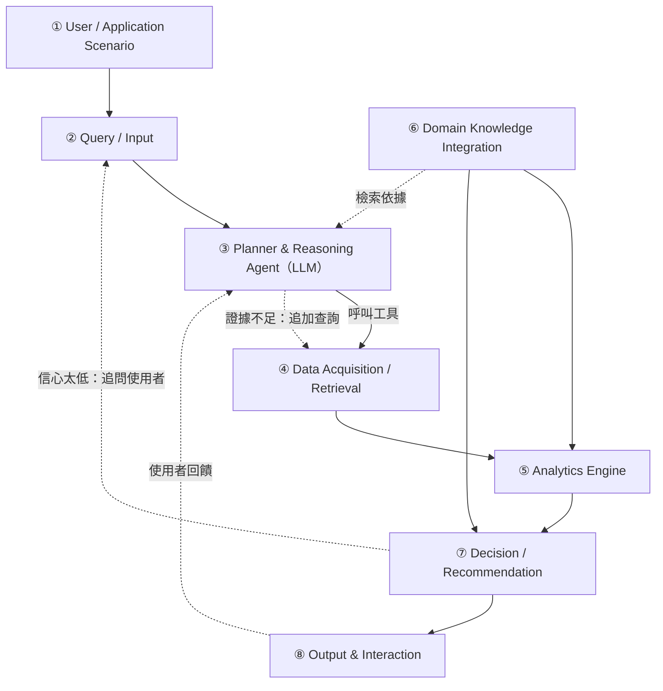

# DESIGN.md — AirSleuth 系統設計文件

> 由總指揮（Claude）維護。依作業規範，這份文件要讓「原開發者不在時，下一位開發者也能理解、執行、驗證並繼續開發」。
> 章節順序照規範：Problem → Requirements → Architecture → Components → Data → AI/Analytics → Domain Knowledge → Algorithm → Implementation → How to Run → Results
> 狀態：**Proposal 版（2026-10-19）**。第 9、11 節在期末階段補完。
> 詳細論述見 `proposal/04_proposed_scheme.md`；文中的 `S-xxx` 對應 `research/sources.md`。

## 1. Problem

台灣有約 1.1 萬個公開的微型空品感測器（S-001），但民眾拿到的仍然只是「數字和顏色」：

- **不知道為什麼。**同樣是 PM2.5 偏高，附近有污染源和整個區域受影響，應對方式完全不同。現有服務不做這個判斷。
- **不知道該怎麼做。**活動建議只依族群分類，沒有結合個人的時間、地點與活動；只給數字時，照警示行動的比例中位數只有 31%（S-028）。
- **不知道該信哪個數字。**微型感測器、國家測站、國外報告的數字都不同（S-022），微型感測器在高濕度時會高估（S-008、S-009）。

2025 年全國 PM2.5 平均 12.8 μg/m³，仍未達到 2030 年的新標準 12，是 WHO 指引值 5 的 2.5 倍（S-022、S-016、S-020）。

## 2. Requirements

### 功能需求

| ID | 需求 | 對應模組 |
|---|---|---|
| FR-1 | 接受自然語言提問，辨識地點、時間、使用者族群、活動 | ② |
| FR-2 | 依問題自動決定要取得哪些資料，證據不足時追加查詢 | ③ |
| FR-3 | 整合微型感測器、國家測站、氣象資料 | ④ |
| FR-4 | 判斷污染比較可能是局部來源或區域傳輸，並說明依據 | ⑤ |
| FR-5 | 預測未來 1～6 小時的 PM2.5 趨勢 | ⑤ |
| FR-6 | 依健康指引與使用者情境產生具體、可行動的建議 | ⑥⑦ |
| FR-7 | 每項結論都附上證據、信心程度與資料來源 | ⑦⑧ |

### 非功能需求

| ID | 需求 |
|---|---|
| NFR-1 | 回答中的每個數字都可以追溯到某次工具查詢（防止 LLM 幻覺） |
| NFR-2 | 資料取得失敗時能降級運作（改用本地資料庫或國家測站），並告知使用者 |
| NFR-3 | 低成本感測器的讀數必須先經過品質檢查 |
| NFR-4 | 判斷門檻與健康規則寫成結構化資料，結果可重現 |

## 3. Architecture



- 完整架構圖：`diagrams/architecture.mmd`
- 流程圖：`diagrams/flowchart.mmd`
- **核心原則：**LLM 只負責規劃、推理與表達；計算、門檻判斷與數字全部由確定性的程式產生。

## 4. Components

| 編號 | 模組 | 職責 | 實作位置 | 狀態 |
|---|---|---|---|---|
| ① | User / Application Scenario | 家長、氣喘患者、運動者、長者照顧者、通勤者 | — | 已定義 |
| ② | Query / Input | 解析地點、時間窗、族群、活動強度；不明確就追問 | `src/agent/pipeline.py`（`Query`） | 原型：結構化輸入；自然語言解析待期末 |
| ③ | Planner & Reasoning Agent | ReAct 式推理與工具呼叫、證據充分性檢查、可追溯性檢查 | `src/agent/`（`pipeline.py`、`tools.py`、`schema.py`） | 原型：固定流程＋8 個工具與 JSON 規格；LLM 規劃待期末 |
| ④ | Data Acquisition / Retrieval | 微型感測器、國家測站、氣象；本地資料庫；品質檢查 | `src/data/` | **感測器與品質檢查已完成** |
| ⑤ | Analytics Engine | 可信度評估、校正、空間型態分析、來源判斷、短期預測 | `src/analytics/` | 初步完成（T-20、T-11、T-21、T-22） |
| ⑥ | Domain Knowledge Integration | 健康指引規則、專家觀念、文獻知識庫 | `src/knowledge/health.py`、`research/` | 原型：新版 AQI、敏感族群、運動取捨規則已實作 |
| ⑦ | Decision / Recommendation | 暴露評估、風險分級、行動排序、信心程度 | `src/knowledge/health.py`、`src/agent/pipeline.py` | 原型：Algorithm 3 排序與信心程度已實作 |
| ⑧ | Output & Interaction | 四段式回答（結論、原因、建議、信心）、追問 | 待定 | 規劃中 |

## 5. Data

| 資料 | 來源 | 欄位 | 頻率與保留 | 已知問題 |
|---|---|---|---|---|
| 微型感測器 | 民生公共物聯網 SensorThings API `https://sta.colife.org.tw/STA_AirQuality_EPAIoT/v1.0/` | station_id、經緯度、PM2.5、相對濕度、溫度 | 約每分鐘；**API 只保留最近約 4～5 小時** | 臺中市約 20% 感測器沒有回傳；**臺中的濕度欄位不可靠**（5 天資料中約 28% 的資料列回報 0，其餘正常資料有 74% 回報 90–100%，T-20），校正改用氣象署濕度；部分縣市沒有鄉鎮欄位；縣市名稱要用「臺」 |
| 本地資料庫 | `data/raw/{colife,moenv,cwa}/<縣市>/YYYY-MM-DD.csv.gz` | 三種來源各自的欄位 | Windows 排程**每小時**收集（`scripts/collect_scheduled.py`） | 電腦關機時會中斷 |
| 國家空品測站 | 環境部縣市小時值（臺中 `aqx_p_142`、高雄 `aqx_p_150`） | PM2.5、PM10、濕度、溫度、風向、風速、雨量 | 每小時；**可回溯好幾個月**（已補抓 60 天） | 臺中 6 站、高雄 12 站，很稀疏；無效值以符號標記 |
| 氣象 | 中央氣象署自動氣象站 `O-A0001-001` | 風向、風速、溫度、濕度、氣壓 | 只給最新一筆，每小時收集 | 臺中 61 站、高雄 63 站；缺值以 -99 表示 |

資料品質旗標（`src/data/quality.py`）：`pm25_missing`、`pm25_negative`、`pm25_extreme`（> 500）、`stuck`（連續 12 個 5 分鐘區間數值相同）、`rh_invalid`（不在 0–100 之間）。

## 6. AI / Analytics

| 元件 | 方法 | 依據 |
|---|---|---|
| Agent | LLM + 工具呼叫，ReAct 式推理 | S-035、S-036、S-039 |
| 可信度評估 | 規則：濕度、完整度、與鄰近感測器一致性 | S-008、S-009、S-010 |
| 校正 | 以國家測站為錨點的濕度修正；之後比較隨機森林 | S-011、S-041、S-043 |
| 空間型態分析 | 區域背景（15 km 中位數）、局部超量、空間一致性 | S-045、S-046、S-047 |
| 來源判斷 | 規則式分類：區域型／局部型／混合型／疑似感測器異常／無明顯事件 | 見第 8 節 Algorithm 2 |
| 短期預測 | 基準：多元線性迴歸；對照：持續性預測 | S-048、S-049（進階方向） |

**為什麼來源判斷用規則而不是深度學習：**目前沒有「事件是局部還是區域」的標記資料可以訓練；規則式方法可解釋，正好符合「每個結論都附證據」的需求。期末若累積足夠的人工標記事件，再評估是否改用學習式方法。

## 7. Domain Knowledge

### 健康指引（2025 年起新版 AQI，PM2.5 24 小時平均，S-029）

| AQI | 等級 | PM2.5（μg/m³） |
|---|---|---|
| 0–50 | 良好 | 0.0–12.4 |
| 51–100 | 普通 | 12.5–30.4 |
| 101–150 | 對敏感族群不健康 | 30.5–50.4 |
| 151–200 | 對所有族群不健康 | 50.5–125.4 |
| 201–300 | 非常不健康 | 125.5–225.4 |

敏感族群：心臟、呼吸道及心血管疾病患者、孩童、老年人、氣喘患者（S-032）。

### 專家觀念 → 系統設計

| 專家觀念 | 依據 | 在系統中的實作 |
|---|---|---|
| 濃度不等於暴露量 | S-034 | ⑦ 暴露評估納入停留時間、活動強度、室內外 |
| 沒有安全閾值 | S-020、S-021 | 綠燈時仍對心肺疾病患者提供提醒 |
| 短期高峰有健康效應 | S-027、S-031 | ⑤ 預測到小時層級，而不只看日平均 |
| 敏感族群風險較高 | S-024、S-031 | ⑦ 敏感族群提前一級警示 |
| 運動的好處通常大於空污風險 | S-033 | ⑦ 一般濃度下建議調整而不是取消運動 |
| 微型感測器看相對、測站看絕對 | S-008、S-022 | ⑤ 濕度高時降低信任，以測站校正 |
| 天氣決定擴散 | S-004、S-023 | ⑤ 來源判斷納入風向與季節 |
| 建議要具體可行動 | S-028 | ⑧ 固定輸出具體行動，而不是只說「空氣不好」 |

## 8. Algorithm

完整的三個演算法（主流程、來源判斷、個人化建議）見 `proposal/04_proposed_scheme.md` 第 4.4 節。

**來源判斷的門檻（2026-10-24 多天資料驗證後）：**

| 參數 | 值 | 說明與驗證狀態 |
|---|---|---|
| 局部／次區域／區域半徑 | 2 km／8 km／15 km | 次區域尺度依臺中 10/19 沿海事件（約 8 km）加入 |
| 最少可信感測器 | 5 個 | 不足就擴大半徑，最多 2 次 |
| 升高 | 比自己前 6 小時中位數高 50% **且至少高 5 μg/m³** | 絕對門檻於多天實測後加入：空氣很乾淨時只看比例會誤判（`spatial.is_rising`） |
| 區域型 | C ≥ 0.6 且 E < max(5, 0.3·B) | **已用真實事件驗證：**高雄 10/23 11:05～12:55，國家測站 12 站中 8 站同時上升 |
| 次區域型 | C_sub ≥ 0.3、外環 C_ring < 0.3、C < 0.6 | 臺中 10/19 驗證；**但 5 天掃描觸發太頻繁**（臺中 11%、高雄 26% 時段），待加入「內圈濃度高於外環」條件 |
| 局部型 | E ≥ max(10, 0.5·B) 且 C < 0.3，且至少 2 個鄰近感測器一起升高 | 只有一個感測器飆高 → 疑似異常 |
| 事件 vs 持續性偏高 | 80% 以上時間高於背景的感測器歸為「持續性偏高」，不算事件 | `spatial.label_station_events` |

完整的多天驗證與限制見 `coordination/reports/T-20.md`；國家測站 60 天的區域型候選見 `coordination/reports/T-21.md`。

## 9. Implementation

| 路徑 | 內容 | 狀態 |
|---|---|---|
| `src/data/colife.py` | SensorThings API 串接、5 分鐘平均、依日期累積 | ✅ |
| `src/data/quality.py` | 資料品質旗標與摘要 | ✅ |
| `src/data/moenv.py`、`src/data/cwa.py`、`src/data/http.py` | 國家測站、氣象站串接；政府平台的憑證處理 | ✅（T-08） |
| `scripts/collect_scheduled.py`、`scripts/register_task.ps1`、`scripts/backfill_moenv.py` | 每小時排程收集三種資料；補抓測站歷史 | ✅ |
| `tests/` | 33 個離線測試（資料串接與品質 6、空間分析 9、預測 4、區域事件 4、校正 4、Agent 原型 6） | ✅ |
| `src/analytics/spatial.py` | 空間型態分析、來源判斷（Algorithm 2）、事件型態標記 | ✅ 初步（T-20） |
| `notebooks/T-20_spatial_eda.ipynb` | 真實資料探索與圖表 | ✅ 初步 |
| `src/analytics/forecast.py`、`notebooks/T-11_*` | 短期預測基準（持續性 vs 多元線性迴歸） | ✅ 初步（T-11） |
| `src/analytics/regional.py`、`notebooks/T-21_*` | 國家測站的區域型事件候選 | ✅ 初步（T-21） |
| `src/analytics/calibration.py`、`notebooks/T-22_*` | 共置比對、線性＋外部濕度校正 | ✅ 初步，5 天共置資料：MAE 改善臺中 23%、高雄 11%（T-22） |
| `src/agent/`、`src/knowledge/`、`docs/agent_demo/` | Agent 工具層原型（8 個工具、Algorithm 1／3、四段式回答與工具紀錄）；三個真實情境的輸出 | ✅ 原型；LLM 規劃待期末 |

## 10. How to Run

```bash
python -m venv .venv
.venv\Scripts\activate
pip install -r requirements.txt
python -m pytest -q tests
python -m src.data.colife cities
python -m src.data.colife snapshot --city 臺中市 --out data/sample/check.csv
powershell -ExecutionPolicy Bypass -File scripts\register_task.ps1
```

## 11. Results

Proposal 階段只寫預期成果（Expected Outcomes），見 `proposal/04_proposed_scheme.md` 第 4.5 節。**不得捏造結果。**

## 12. Limitations

- **資料：**API 只保留約 4～5 小時，歷史資料要自行累積或向國網中心申請；本專題只收集臺中市與高雄市。
- **感測器：**濕度資料常無效，校正依賴國家測站，而國家測站很稀疏。
- **來源判斷：**是根據空間型態的推論，不是化學成分的源解析；能區分「局部」與「區域」，但**無法確定區域污染是境外還是國內其他地區**（T-18 爭議 1）。
- **門檻：**區域型（高雄 10/23）、次區域型（臺中 10/19）各只有一個真實案例驗證，且都在秋季；次區域型規則觸發太頻繁，尚待改良；門檻可能因城市而異。
- **校正：**T-22 的校正係數只來自秋季 5 天（測站濕度 40～100%），還沒做依日期切分的驗證；臺中、高雄偏差方向相反，係數必須在地化；國家測站小時值的時間標記慣例尚未確認。
- **尺度：**固定的 2 km／15 km 無法描述大小不同的事件（T-20 的沿海群聚約 8 km）。
- **健康建議：**是一般性的公衛建議，不能取代醫療建議。
