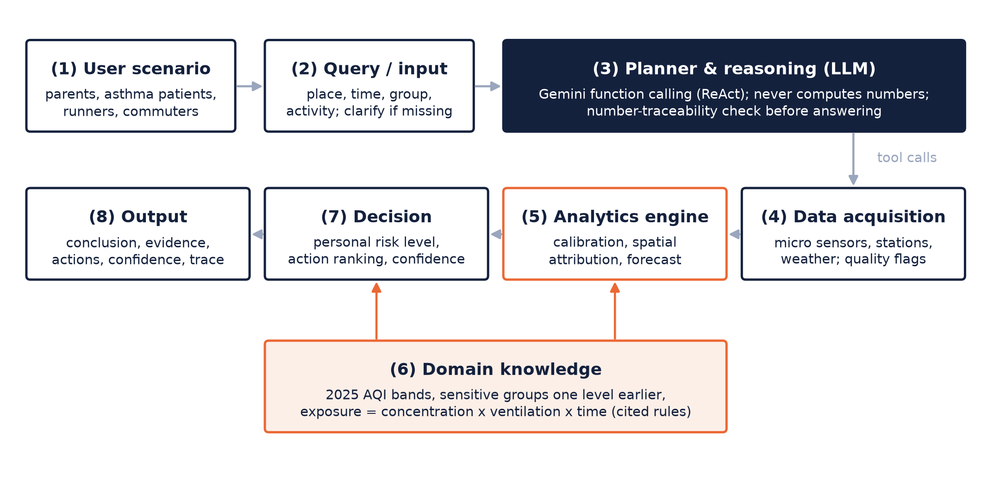
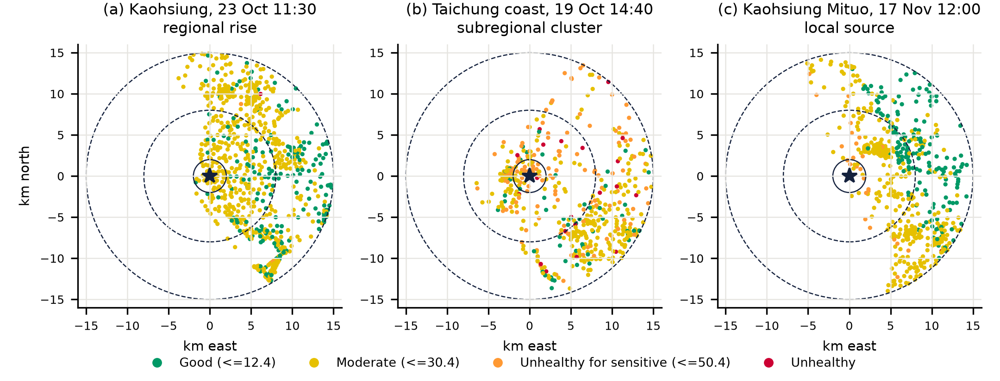

## 1. Introduction

Ambient air pollution caused an estimated 7.9 million deaths worldwide in 2023 [S-060], and the World Health Organization recommends an annual PM_{2.5} guideline of 5 μg/m³ [S-020]. Taiwan tightened its standards to 12 μg/m³ (annual) and 30 μg/m³ (daily) and introduced a revised air quality index (AQI) in 2025 [S-016]. Public guidance, however, remains a color plus a group-level recommendation [S-032], and in a systematic review only a median of 31% of people actually changed their outdoor activities in response to alerts, with poor understanding of the index among the barriers [S-028].

The Internet of Things (IoT) offers a way forward. Taiwan's national programme planned 10,200 low-cost PM_{2.5} sensors [S-013], and the readings are openly available through a SensorThings API [S-001]. A dense network can show what a sparse reference network cannot: whether a rise is confined to a few kilometres or covers the whole region. The distinction changes the advice: moving a few kilometres helps against a local source but not against a regional episode.

Three obstacles prevent this from happening today. First, low-cost readings are biased and humidity-sensitive [S-008, S-009], and correction models do not transfer between places [S-010, S-058]. Second, separating local sources from background is still an open problem with no single best method [S-057]. Third, large language models (LLMs) make data conversational but invent numbers. Recent air-quality agents orchestrate reference data for analysts [S-053, S-054, S-036, S-037], but none of them handles low-cost sensor quality, spatial attribution and personal decisions together.

This paper presents AirSleuth, a domain AI agent for PM_{2.5} built on public IoT data. Its contributions are as follows:

1. An architecture in which the LLM plans and explains while every number and decision comes from deterministic, logged tools, enforced by a number-traceability check;
2. A multi-scale spatial attribution method (local, subregional, regional, sensor fault) evaluated with semi-synthetic injections on real background fields;
3. An evaluation on real data from two Taiwanese cities covering calibration, forecasting and a 40-question comparison of agent designs;
4. An open-source implementation with a public demo, specifications and reproducible experiments.

## 2. Related Work

### 2.1. LLM Agents and Tool Use

ReAct interleaves reasoning with actions [S-035]. A survey of 45 data science agents found that more than 90% lack explicit trust or safety mechanisms [S-055]. In air quality, Neuro-Air coordinates five agents over reference data and reaches 88.4% accuracy on verifiable tasks [S-053], an instructor–worker system analysed the 2025 Los Angeles wildfires [S-054], and other systems expose monitoring data through the Model Context Protocol [S-036] or generate analysis code from questions [S-037]. These systems serve analysts and trust their inputs; AirSleuth serves residents and treats sensor quality as part of the reasoning.

### 2.2. Low-Cost Sensors and Source Separation

Raw PurpleAir readings over-estimate PM_{2.5} by about 40% in most of the United States, and adding humidity improves linear corrections [S-008, S-009]. Model performance varies by site [S-010]; in Taiwan, a single nationwide AirBox formula performs poorly and spatially varying coefficients are needed [S-058]. Methods to separate local from background signals include spatial networks, peak finding and spectral filters, none of which is uniformly best [S-057].

### 2.3. Health Advice

Physical activity remains beneficial in most polluted settings [S-033], but in 1.5 million adults its protective association with mortality dropped from about 30% to 12–15% at PM_{2.5} ≥ 25 μg/m³ [S-061]; exposure also depends on where and how long people stay outdoors [S-034].

## 3. System Design

### 3.1. Architecture

Figure 1 shows the eight modules. The planner (3) is Gemini 3.5 Flash-Lite with function calling. It sees three coarse tools: *resolve_place*, which maps 67 district names or coordinates to locations; *analyze_air_quality*, which runs modules (4)–(7) deterministically and returns structured facts; and *retrieve_knowledge*, which returns domain rules with their sources. Inside *analyze_air_quality*, eight data tools run in a fixed order and every call is logged. Before an answer is returned, every number followed by a unit (μg/m³, %, km, m/s) must match a tool value within rounding. Otherwise the LLM rewrites once, and the deterministic answer is used if the rewrite fails.

{width=12.0}

### 3.2. Data and Quality Control

Micro-sensor observations (about one per 5 min) come from the SensorThings API [S-001], hourly reference values from the national stations, and wind, temperature and humidity from automatic weather stations, all collected hourly. Tools read only data available at the query time, so past events replay exactly. Each record receives one quality flag (missing, negative, extreme, stuck, invalid humidity). Rows with invalid humidity keep their PM_{2.5} value, and humidity for calibration comes from the nearest weather station.

### 3.3. Spatial Source Attribution

For a query point, the regional background *B* is the median of usable sensors within 15 km, and the local level *L* is the median within 2 km. The local radius doubles up to 8 km when fewer than five sensors are available. The local excess is *E* = *L* − *B*. A sensor is rising when its value exceeds the median of its own previous 6 h by more than 50% and by at least 5 μg/m³; the absolute term prevents clean-air noise from counting as a rise. Coherence *C* is the share of rising sensors within 15 km, *C*_{sub} the share within 8 km and *C*_{ring} the share between 8 and 15 km. The rules are checked in order:

- regional if *C* ≥ 0.6 and *E* < max(5, 0.3*B*);
- subregional if at least five sensors lie within 8 km, *C* < 0.6, *C*_{sub} ≥ 0.3 and *C*_{ring} < 0.3;
- local if *E* ≥ max(10, 0.5*B*), *C* < 0.3 and at least two nearby sensors are also elevated, and suspected sensor fault if fewer are;
- mixed if *C* ≥ 0.6 and the excess is large;
- no clear event otherwise.

Medians make a single faulty sensor unable to move *L*.

### 3.4. Calibration, Forecasting and Decision

Each city has its own calibration, reference = *a* + *b*·sensor + *c*·RH, fitted against co-located stations with the humidity of the nearest weather station (Section 5.1).

A multiple linear regression (MLR) forecasts the nearest station 1, 3 and 6 h ahead and is trained only on targets observed before the query time. The predicted change is transferred to the query point and bounded to −50%/+100% of the local value. It is not transferred when the station shows an isolated spike, defined as at least twice its 6-h median, at least 15 μg/m³ above it, and at least 15 μg/m³ above the nearby sensors.

The decision module maps the calibrated value to the 2025 AQI and warns sensitive groups one category earlier [S-032]. It then ranks the candidate actions by activity benefit minus a level-dependent weight times exposure, where exposure is concentration × ventilation × duration [S-034]. The candidates are: proceed, lower intensity, delay, move more than 8 km and move indoors. Benefit is discounted at ≥25 μg/m³ for people already at elevated risk [S-061]. "Move" is offered only for local or subregional events, and "delay" or "move" only when they lower the concentration by at least 5 μg/m³. Confidence drops for each of four conditions: fewer than five local sensors, humidity of at least 85%, an uncertain source type, or data older than 30 min.

## 4. Data and Experimental Setup

Table 1 lists the data. Micro-sensor collection stopped twice: the API was unreachable from 1 to 9 November, and its TLS certificate expired on 21 November 2026. Because we never disable certificate verification, all experiments use the fixed period below.

Table 1. Data used in the experiments (Taichung and Kaohsiung).
| Source | Period (2026) | Sites | Records |
|-------------|-------------|-------|-------|
| Low-cost sensors (Civil IoT) | 19 Oct–18 Nov, 528 h with data | 1191 + 1369 | 15.5 M (5-min) |
| National monitoring stations | 20 Aug–24 Nov | 6 + 12 | hourly |
| Automatic weather stations | 19 Oct–24 Nov | 61 + 63 | hourly snapshots |

The experiments are as follows:

- **E1 (forecasting).** Persistence, MLR, random forest and histogram gradient boosting are trained on 20 August–13 October; tree ensembles are tuned with Optuna (30 trials, fixed seed) on 14–26 October and tested once on 27 October–24 November.
- **E2 (calibration).** Leave-one-site-out cross-validation compares sensor medians within 1 km of each station with the station value.
- **E3 (attribution).** In each city we sample 40 clean hours (fewer than 5% of sensors rising) at dense query points and inject a +10/15/25 μg/m³ plume within 2 km (local), +8/12/20 within 6 km (subregional), +8/12/20 with noise within 15 km (regional), +40 on a single sensor (fault) or nothing. The 880 cases compare AirSleuth with an ablation without the 8 km tier, an AQI-only rule (nearest sensor above the "moderate" band means a region-wide event) and a nearest-sensor rule (nearest sensor ≥10 μg/m³ above the 15 km median means local).
- **E4 (agent).** 40 Traditional Chinese questions over six real moments: 24 answerable, 6 needing clarification, 5 out of scope and 5 conceptual. Four designs answer them: AQI-only rules, LLM only, LLM with raw-data tools (no quality control, calibration, attribution or domain rules), and AirSleuth, all with the same Gemini model. Expected actions come from the deterministic policy.

## 5. Results

### 5.1. Forecasting and Calibration

Table 2 summarises E1 and E2. Gradient boosting reduces the 6-h error by 17% relative to persistence and by 0.2 μg/m³ relative to MLR. We keep MLR in the agent because its coefficients can be explained to users, and the difference is small. Calibration removes the opposite biases of the two cities (Taichung sensors read high, Kaohsiung sensors low). In Taichung the humidity term helps: at a relative humidity of at least 90%, the median sensor-to-station ratio was 2.09. The Taichung coefficients from four weeks (3.21, 1.08, −0.094) were close to those from five days, while the Kaohsiung humidity term vanished.

Table 2. E1 forecast error at the national stations (test period, 18 stations) and E2 calibration (leave-one-site-out).
| Experiment | Setting | Persistence / raw | MLR / linear | Best |
|------------|----------|------|------|---------|
| E1 MAE, 1 h | μg/m³ | 3.35 | 3.19 | 3.16 (boosting) |
| E1 MAE, 3 h | μg/m³ | 4.60 | 4.29 | 4.10 (boosting) |
| E1 MAE, 6 h | μg/m³ | 5.69 | 4.97 | 4.74 (boosting) |
| E1 AQI-band hit, 6 h | rate | 0.67 | 0.71 | 0.72 (boosting) |
| E2 MAE, Taichung | 6 sites, 3108 h | 4.07 | 3.36 | 3.24 (linear + RH) |
| E2 MAE, Kaohsiung | 11 sites, 5698 h | 3.52 | 3.02 | 3.02 (linear) |

### 5.2. Spatial Source Attribution

Figure 2 shows three real episodes, which AirSleuth classifies correctly:

- **Kaohsiung, 23 October.** 90% of the sensors within 15 km rose together (*C* = 0.90, *E* = 3.7), so the advice for a child was to lower intensity, not to move. The nearest station still reported 5 μg/m³ for 10:00, while the calibrated local value was 21.4 μg/m³.
- **Taichung coast, 19 October.** The rise was concentrated within 8 km (*C*_{sub} = 0.38, *C*_{ring} = 0.04). Moving more than 8 km lowers the exposure from 36.9 to about 23 μg/m³.
- **Kaohsiung Mituo, 17 November.** Nine sensors stood 14.3 μg/m³ above a 16.7 μg/m³ background while no sensor in the region was rising, so the event was classified as local.

{width=12.0}

On the semi-synthetic cases (Table 3), AirSleuth reaches 84% accuracy and a macro-F1 of 0.80. The index-only rule cannot distinguish source types. The nearest-sensor rule detects local plumes as well as AirSleuth but labels every single-sensor fault as a local source. AirSleuth labels 1% of the faults as local, because medians ignore the faulty sensor. Removing the 8 km tier drops subregional recall from 0.88 to 0 and macro-F1 to 0.51. Most AirSleuth errors involve weak signals. A +10 μg/m³ plume sits at the local threshold (recall 0.38), and a +8 μg/m³ regional rise often fails the "50% and 5 μg/m³" rising test on moderately polluted backgrounds (recall 0.52). These rules were chosen to suppress false alarms in clean air.

Table 3. E3 semi-synthetic evaluation (80 real backgrounds × 11 scenarios).
| Method | Accuracy | Macro-F1 | Local | Subregional | Regional | Fault → local |
|------------|----|----|----|-----|----|----|
| AirSleuth | 0.84 | 0.80 | 0.74 | 0.88 | 0.81 | 0.01 |
| Ablation: no 8 km tier | 0.62 | 0.51 | 0.80 | 0.00 | 0.81 | 0.01 |
| Baseline A: AQI only | 0.19 | 0.15 | 0.00 | 0.00 | 0.36 | 0.00 |
| Baseline B: nearest sensor | 0.51 | 0.49 | 0.79 | 0.00 | 0.78 | 1.00 |
> Local, Subregional and Regional give recall; the last column gives the share of single-sensor faults labelled as local (lower is better).

### 5.3. Agent Evaluation

Table 4 compares the four designs. A judge prompt on the same model labelled the first recommended action of each LLM answer. On AirSleuth's answers, whose ranking is known, the judge agreed in 24 of 24 cases.

Without tools, the LLM stated a specific current PM_{2.5} or AQI value that it could not know in 46% of its answers, and its advice matched the guidance in 25%. Given raw-data tools but no quality control, calibration, attribution or domain rules, the LLM quoted traceable numbers in 91% of cases, yet matched the guidance in only 33%. During the Kaohsiung regional rise, for example, it trusted the station's 5 μg/m³ and told a parent that running was fine, ignoring both the 21 μg/m³ seen by the sensors and the earlier warning for children. Neither LLM baseline suggested moving in the three local or subregional cases, and each suggested moving once during a regional event.

AirSleuth kept all numbers traceable and matched the guidance in 23 of 24 answers; the miss read "play in the park" as walking. It handled every clarification and refusal correctly and needed 2.4 LLM calls and 11 s per question.

The evaluation also exposed a defect. The first version answered conceptual questions without the knowledge tool and once quoted the pre-2025 AQI range. We routed such questions to the knowledge tool, extended the traceability check to every reply, and made the fallback list the cited rules. Conceptual accuracy then rose from 40% to 100%. Because this fix was guided by the test questions, the conceptual result is development evidence rather than a held-out estimate.

Table 4. E4 comparison on 40 questions (Gemini 3.5 Flash-Lite for all LLM designs).
| Design | Traceable numbers | Invented current values | Action agreement | Clarification | Refusal | Concept |
|-----------|-----|-----|-----|-----|----|----|
| AQI only | 1.00 | 0.00 | 0.46 | n/a | n/a | n/a |
| LLM only | n/a | 0.46 | 0.25 | 0.67 | 0.20 | 0.80 |
| LLM + raw-data tools | 0.91 | 0.00 | 0.33 | 1.00 | 0.80 | 0.80 |
| AirSleuth | 1.00 | 0.00 | 0.96 | 1.00 | 1.00 | 1.00 |
> The set contains 24 answerable, 6 clarification, 5 refusal and 5 conceptual questions. "Traceable numbers" is the share of numbers with units that appear in tool outputs; the LLM-only design stated none. One expected label was corrected because its question did not state a duration.

### 5.4. Failure Cases Found with Real Data

Replaying real moments exposed three policy errors that synthetic tests had missed. On 29 October the Dali station reported 74 μg/m³ for 18:00 while its 23 neighbouring sensors had a median of 13.8 μg/m³; transferring the station's forecast, which reverted the spike, predicted 0 μg/m³ for the query point, and the spike guard of Section 3.4 now prevents this. Before the 5 μg/m³ minimum gain was added, the agent advised a 6-h delay when the air was already "good" (11.5 μg/m³). Applying the benefit discount to everyone sent the general public indoors at 26 μg/m³, contrary to the guidance for the "moderate" band [S-032]; the discount now applies only from the sensitive level upwards.

## 6. Discussion

The results support three design choices: tool grounding makes every statement traceable and testable, spatial context changes the right action, and robust statistics make the agent resilient to faulty sensors.

Three trade-offs remain: simpler forecasting models are less accurate but explainable; conservative rising rules miss weak events; and the action weights encode guidance and evidence but are partly assumptions that need user studies.

Limitations remain. Semi-synthetic labels test the algorithm's logic, not agreement with chemical source apportionment; the expected actions encode official guidance rather than health outcomes; coefficients and thresholds come from two cities over one autumn; and the certificate outage shows that the public data supply itself must be monitored.

## 7. Conclusions

AirSleuth shows that a tool-grounded LLM agent can turn a noisy public IoT network into explainable, personalised advice. The LLM handles language and planning; quality control, calibration, spatial attribution, forecasting and decision rules handle the numbers. On real data from Taichung and Kaohsiung, the attribution method separates local, subregional and regional rises far better than index-only or nearest-sensor rules, and the agent keeps its numbers traceable. Future work will add winter data and more cities, field-validate attribution against source apportionment, and run a user study of the advice. Code, data samples, specifications and a demo are available in the project repository.

## Back Matter

**Author Contributions:** Conceptualization, methodology, software, validation and writing were carried out by the project team; [individual roles to be filled in]. All authors have read and agreed to the published version of the manuscript.

**Funding:** This research received no external funding.

**Data Availability Statement:** Code, specifications, experiment results and demo data are available at https://github.com/A0966411725-png/AirSleuth; raw data are public through the cited open-data platforms.

**Acknowledgments:** Claude (Anthropic) assisted with coding, analysis and drafting, and Gemini (Google) is the agent's language model; the authors reviewed all output and take full responsibility for the content.

**Conflicts of Interest:** The authors declare no conflicts of interest.
