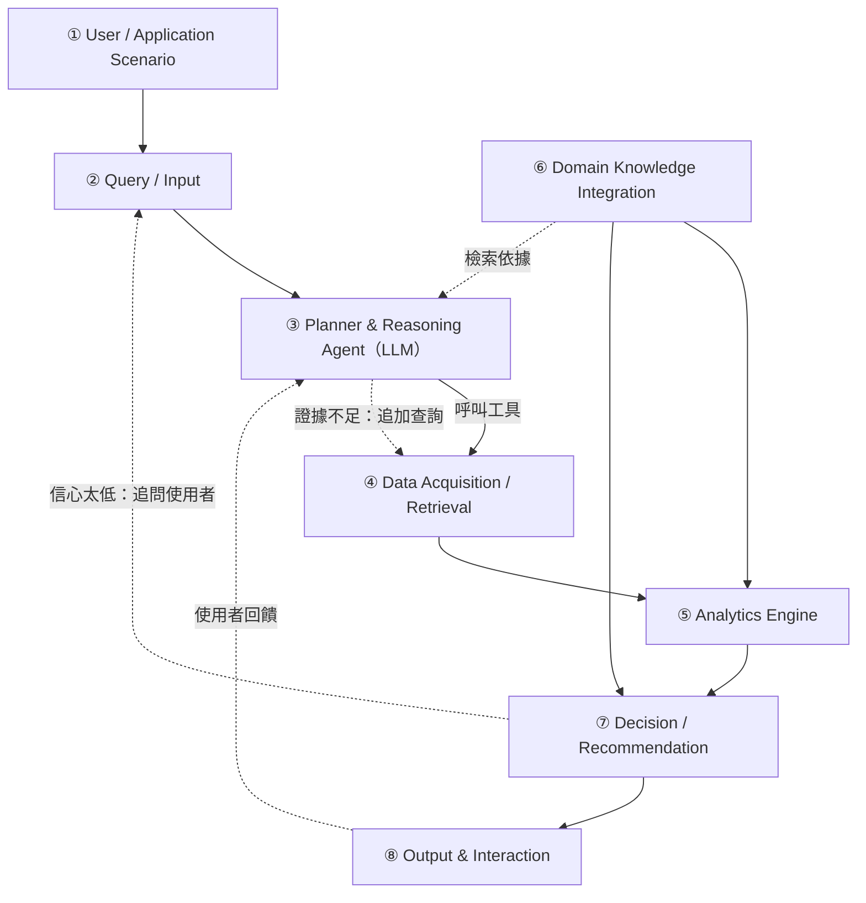
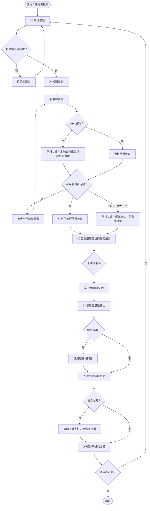
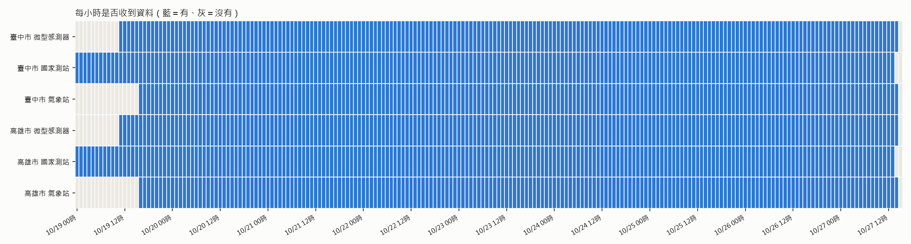
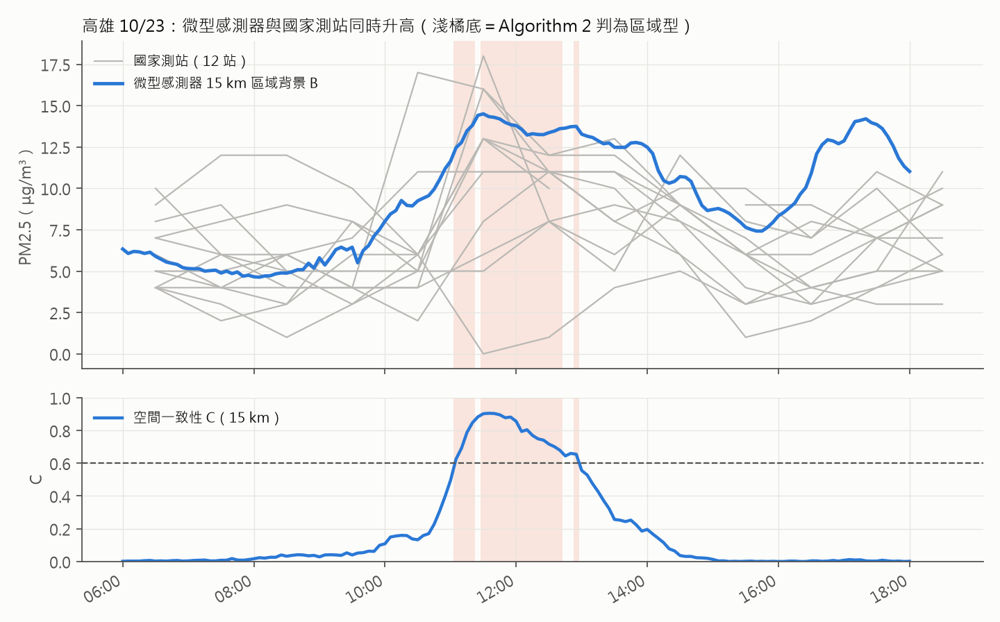
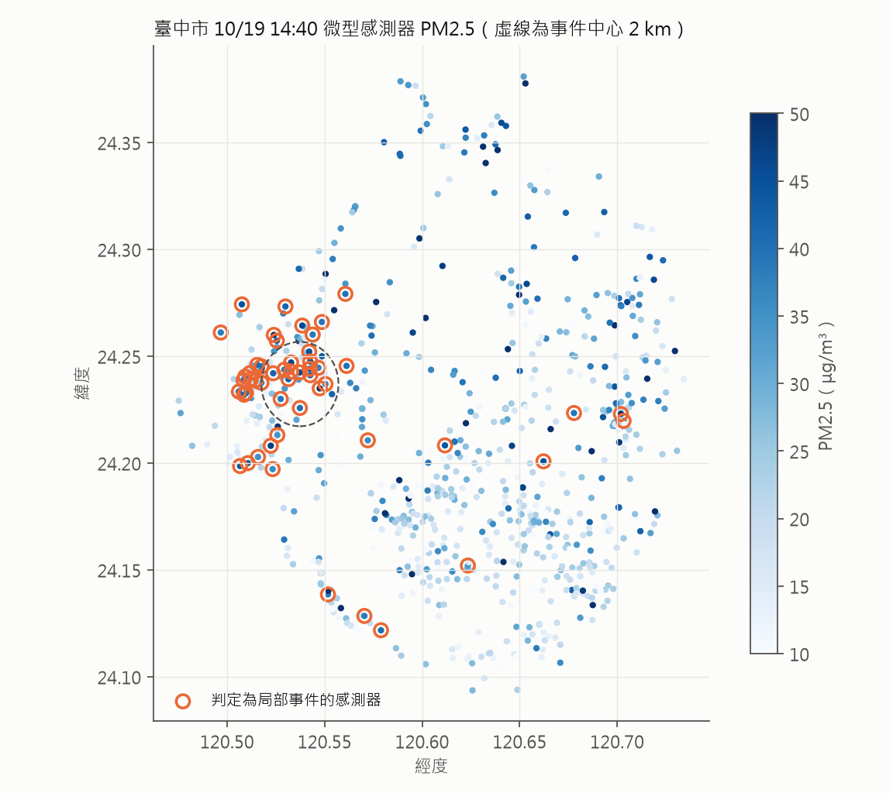
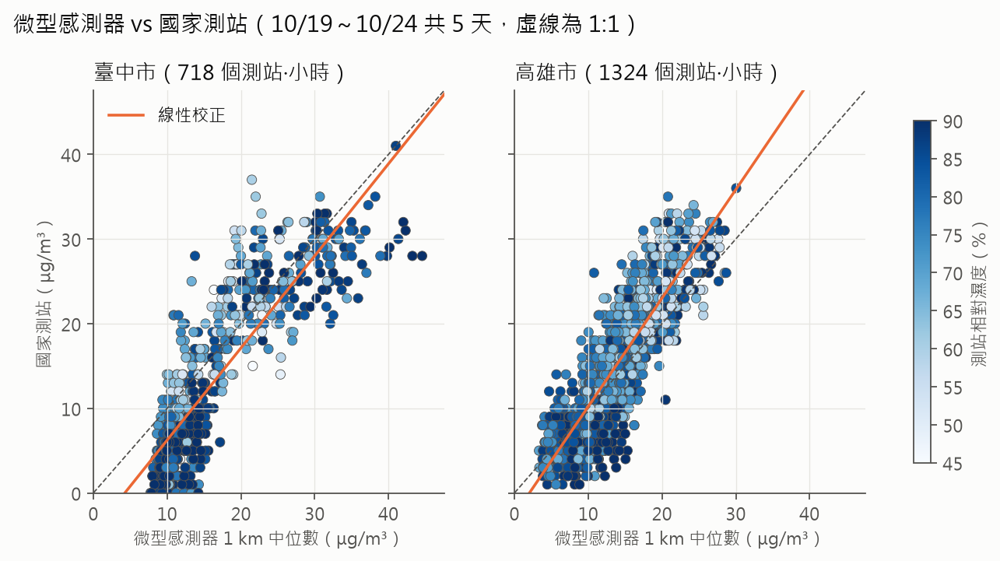
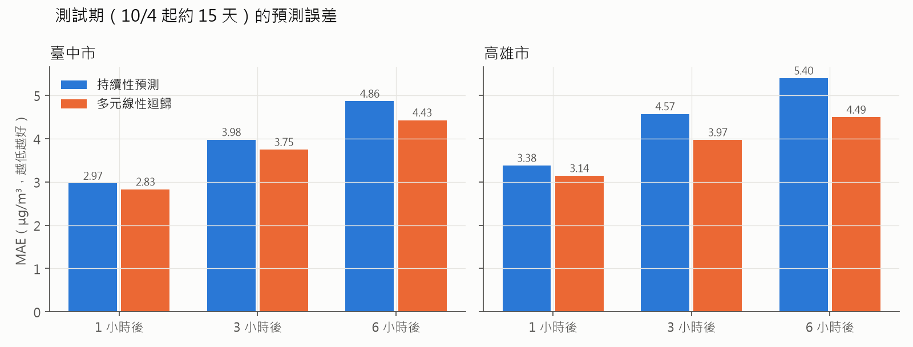

# 04 Proposed Scheme 系統設計

> 負責：Claude（T-10）｜版本：2026-10-19 初稿
> 模組編號 ①～⑧ 與 `DESIGN.md` 第 4 節一致；圖檔原始碼在 `diagrams/`。
> 文中的 `S-xxx` 對應 `research/sources.md`；「實測」指本專題 T-07 對民生公共物聯網資料的實際分析。

## 4.0 設計原則：從研究發現推導出的五條規則

AirSleuth 的每個設計決定，都來自前面的文獻與實測，而不是憑空設計：

| # | 設計原則 | 依據 | 落在哪個模組 |
|---|---|---|---|
| P1 | **所有數字都必須來自工具查詢，不能由 LLM 自己生成** | LLM 會幻覺，工具呼叫可以降低幻覺（S-035、S-036） | ③④ |
| P2 | **先確認資料可不可信，再做判斷** | 微型感測器高估約 40%、濕度是最大誤差來源（S-008、S-009）；實測發現約 41% 的臺中感測器有時回報濕度為 0 | ④⑤ |
| P3 | **用當下的空間型態判斷來源，不引用單一的「境外佔 X%」** | 境外 vs 本地沒有單一正確數字，隨季節、地點、天氣而變（T-18 爭議 1）；先扣掉區域背景，剩下的才是局部（S-045、S-047） | ⑤ |
| P4 | **建議要結合使用者的族群、時間、地點與活動，而且要具體可行動** | 濃度不等於暴露量（S-034）；敏感族群風險較高（S-024、S-031）；只給數字時遵從率中位數只有 31%（S-028） | ⑥⑦ |
| P5 | **每個結論都附上證據與信心程度** | 不同資料來源的數字不同，民眾無法判斷（S-022）；專家共識是感測器讀數要附不確定性（S-011） | ⑦⑧ |

## 4.1 System Architecture



完整版（含每個模組的子元件）見 `diagrams/architecture.mmd`。

**架構的三個關鍵特徵：**
1. **LLM 只負責「規劃、推理與表達」**，計算、判斷門檻與數字全部交給確定性的程式（④⑤⑦），所以結果可以重現、可以驗證。
2. **領域知識（⑥）同時餵給分析與決策**，而不只是給 LLM 當背景資料。例如「濕度高時降低感測器信任度」是寫在分析流程裡的規則。
3. **三個回饋迴圈**：證據不足時追加查詢、信心太低時追問使用者、使用者回饋後重新規劃。

## 4.2 模組說明

### ① User / Application Scenario

| 使用者 | 典型問題 | 需要的能力 |
|---|---|---|
| 家長 | 「明天下午能帶小孩去公園嗎？」 | 預測、敏感族群門檻、時段建議 |
| 氣喘患者 | 「我家附近今天為什麼特別差？」 | 來源判斷、局部 vs 區域 |
| 運動者 | 「晚上 7 點去河堤跑步 1 小時 OK 嗎？」 | 暴露估算、運動取捨（S-033） |
| 長者照顧者 | 「要不要開窗、開空氣清淨機？」 | 室內外差異（S-034） |
| 一般通勤者 | 「我騎車上班會經過工業區，要注意什麼？」 | 路線上的局部熱點 |

### ② Query / Input
- **輸入：**自然語言提問，加上可選的使用者設定檔（常用地點、族群、是否有心肺疾病）。
- **處理：**把地址或地標轉成經緯度；把「明天下午」轉成時間窗；辨識活動類型與強度（散步、跑步、騎車）。
- **例外：**地點或時間不明確時，不用猜的，**直接追問使用者**（流程圖中的人機互動）。

### ③ Planner & Reasoning Agent
- **方法：**以 ReAct 方式運作（S-035）：LLM 交錯產生「推理」與「工具呼叫」，看到結果後再決定下一步。
- **可用的工具：**以 JSON 規格提供給 LLM（function calling），規格與實作都已完成（`src/agent/schema.py`、`src/agent/tools.py`）：

| 工具 | 模組 | 輸入 | 輸出 |
|---|---|---|---|
| `get_microsensors` | ④ | 縣市、時間、經緯度、半徑 | 半徑內、前 7 小時的 5 分鐘資料；感測器數、資料新舊 |
| `assess_quality` | ④ | 上一步的資料 | 可用比例、濕度無效比例、排除比例 |
| `get_station` | ④ | 縣市、時間、經緯度 | 最近國家測站上一個完整小時的 PM2.5、濕度、風 |
| `get_weather` | ④ | 縣市、時間、經緯度 | 最近氣象站的風向、風速、濕度、溫度 |
| `source_attribution` | ⑤ | 資料、時間、經緯度、局部半徑 | B、L、E、C、C_sub、C_ring 與來源類型（Algorithm 2） |
| `calibrate` | ⑤ | 縣市、感測器讀數、濕度 | 在地校正後的 PM2.5（T-22 係數） |
| `forecast_trend` | ⑤ | 縣市、時間、經緯度 | 未來 1、3、6 小時預測（MLR） |
| `retrieve_knowledge` | ⑥ | 族群、活動、來源類型 | 相關規則與文獻依據 |

- **證據充分性檢查：**局部範圍內可信感測器少於門檻（5 個）時，自動把局部半徑加倍，最多兩次；仍不足就改用國家測站並把信心降為低。
- **防護規則：**回答中的每個數字都必須對應到某次工具呼叫的結果（P1），否則不輸出；原型會把每次工具呼叫的輸入與輸出記錄下來，作為追溯依據。
- **系統提示（System Prompt）的核心規則：**① 只能使用工具回傳的數字，不可自行估計；② 一律以「結論 → 為什麼 → 建議 → 信心」四段式回答；③ 成因只能描述空間型態（局部、區域），不可斷定是哪一家工廠或境外傳輸；④ 地點、時間不明確時先追問；⑤ 涉及醫療時提醒就醫，不做診斷。

### ④ Data Acquisition / Retrieval

| 資料 | 來源 | 頻率 | 狀態 |
|---|---|---|---|
| 微型感測器 PM2.5、溫度、濕度 | 民生公共物聯網 SensorThings API（S-001） | 約每分鐘 | ✅ 已串接（`src/data/colife.py`） |
| 歷史資料 | 本地資料庫：Windows 排程每小時收集臺中市、高雄市 | 5 分鐘平均 | ✅ 收集中（截至 10/27 已超過 570 萬筆，每小時都有資料） |
| 國家空品測站 | 環境部環境資料開放平臺（縣市小時值） | 每小時，可回溯數個月 | ✅ 已串接（T-08） |
| 風向、風速、溫濕度 | 中央氣象署自動氣象站 | 每小時（排程累積） | ✅ 已串接（T-08） |

- **為什麼需要本地資料庫：**實測發現 API 只保留最近約 4～5 小時，做趨勢與事件比對需要自己累積。
- **資料品質檢查**（`src/data/quality.py`，已實作）：標記缺值、負值、> 500 μg/m³、連續 1 小時數值不變、濕度無效。

### ⑤ Analytics Engine
1. **可信度評估：**每個感測器依濕度是否有效、資料完整度、與鄰近感測器的一致性給一個可信度分數。相對濕度高時（初步設定 > 70%），降低對絕對數值的信任（S-009、S-010）。
2. **測站錨定校正：**有國家測站時，用測站資料做濕度修正（S-008、S-011、S-041 的方法）；沒有測站時只看相對變化。濕度一律用國家測站或最近氣象站的濕度，不用微型感測器自己回報的濕度（T-22 以 5 天資料實測：臺中共置點的感測器濕度平均 97.7%，與國家測站平均差約 24 個百分點；最近氣象站只差約 5 個百分點）。
3. **空間型態分析**（核心，借鏡 S-045 的「區域背景 + 局部事件」分解，以及 S-047 的背景正規化）：
   - **區域背景 B**：半徑 15 km 內可信感測器的 PM2.5 中位數
   - **局部濃度 L**：使用者所在位置半徑 2 km 內的中位數
   - **局部超量 E = L − B**
   - **空間一致性 C**：區域內「比自己前 6 小時基準升高超過 50%，且至少高 5 μg/m³」的感測器比例（借鏡 S-046 用一致變化偵測區域事件）；另外以 8 km 計算次區域一致性 C_sub，以 8～15 km 外環計算 C_ring
4. **來源判斷：**依 E、C、C_sub、鄰近感測器是否一起升高、風向，分成區域型、次區域型、局部型、混合型，另外標出疑似感測器異常與無明顯事件（見 Algorithm 2）。
5. **短期趨勢預測：**未來 1～6 小時。**基準模型用多元線性迴歸**（輸入：過去數小時 PM2.5、濕度、溫度、風速、時段），對照持續性預測（persistence）。T-11 已用國家測站 60 天資料做可行性驗證（見 4.5 節）。

> 門檻（15 km、8 km、2 km、50%、5 μg/m³、0.6、0.3 等）原本是依文獻與常識設定的初始值，**已用 5 天真實資料校準與做敏感度測試（T-20）**：「升高」加入至少 5 μg/m³ 的絕對門檻（T-21 在國家測站也發現同樣問題），避免空氣乾淨時的小波動被當成升高；區域型門檻已用高雄 10/23 的真實事件驗證。次區域型規則目前觸發太頻繁，期末會加入「內圈濃度高於外環」的條件。

### ⑥ Domain Knowledge Integration

| 知識類型 | 內容 | 形式 | 來源 |
|---|---|---|---|
| 健康指引 | 2025 新版 AQI 的 PM2.5 門檻；各等級對一般民眾與敏感族群的建議 | 結構化規則（已實作於 `src/knowledge/health.py`） | S-029、S-032 |
| 專家觀念 | 8 個核心觀念（濃度 ≠ 暴露、沒有安全閾值、短期高峰、敏感族群、運動取捨、感測器看相對、天氣決定擴散、建議要具體） | 規則 + 說明文字 | T-06 |
| 運動與污染的取捨 | 一般濃度下運動效益大於風險；PM2.5 ≥ 25 μg/m³ 時運動降低死亡風險的效果由約 30% 降為 12%～15% | 評分參數 | S-033、S-061 |
| 爭議與不確定性 | 境外 vs 本地、感測器可信度、標準嚴格度的共識與未解問題 | 說明文字 | T-18 |
| 文獻 | 已查核的 62 筆來源摘要 | 文獻知識庫（RAG） | `research/` |

**為什麼不全部交給 LLM 自己判斷：**門檻與規則寫成結構化資料，結果才一致、可以驗證；LLM 只用來把規則套到使用者情境，並用口語解釋。

### ⑦ Decision / Recommendation
1. **暴露評估：**預測濃度 × 停留時間 × 活動強度（呼吸量），區分室內與室外。
2. **個人風險分級：**依新版 AQI 門檻，敏感族群提前一級警示（S-024、S-031、S-032）。
3. **候選行動與排序：**照常進行、改時段、改地點、降低強度、改到室內並開空氣清淨機。排序分數 = 活動效益 − λ(等級) × 暴露量（Algorithm 3 第 8 行）：效益考慮**運動的好處**，一般濃度下不建議直接取消運動（S-033），PM2.5 ≥ 25 μg/m³ 時效益打折（S-061）；λ 依新版 AQI 等級遞增，並調整成與環境部的活動建議一致（「普通」時一般人照常活動，敏感族群提前一級改為減少體力消耗，S-032）。
4. **信心程度：**高／中／低，由資料可信度、可用感測器數量、來源判斷的明確程度決定。信心低時，明確說明並給出較保守的建議。

### ⑧ Output & Interaction

固定的四段式回答，對應 P4、P5。以下是**原型用真實資料產生的回答**（高雄 10/23 11:30，孩童要運動 1 小時；`python -m src.agent.demo --case kaohsiung`，完整輸出與工具紀錄見 `docs/agent_demo/kaohsiung.md`）：

> **結論：**高雄市前金區目前 PM2.5 約 20 μg/m³（新版 AQI「普通」），屬於區域型（整個區域一起升高）。對孩童的建議是：降低強度，改成散步或伸展。
> **為什麼：**2 km 內微型感測器中位數 18.2、15 km 區域背景 14.5 μg/m³，局部超量只有 +3.7；區域內 90% 的感測器比自己前 6 小時明顯升高（8 km 內 99%、外環 85%）。國家測站的小時值要等整點結束才發布（最新是 10:00 那一小時，前金 5 μg/m³），微型感測器已經看到比測站高 15 μg/m³ 的升高。氣象站風向 337°、風速 4.5 m/s；未來 1、3、6 小時預估約 22、24、26 μg/m³。
> **建議：**① 降低強度，改成散步或伸展；② 照原計畫進行；③ 改到室內並關閉門窗。（區域型事件，所以**不建議換地點**。）
> **信心：高。**2 km 內可信感測器 46 個；已用在地係數校正。資料來源：民生公共物聯網、環境部測站、中央氣象署。

Proposal 階段的原型以固定順序呼叫工具、用模板組成句子；期末由 LLM 規劃工具呼叫並以口語表達，但**數字與判斷仍由同一套工具產生**。

## 4.3 Flowchart



完整版（含來源判斷的各種分支與單一感測器異常的處理）見 `diagrams/flowchart.mmd`。

| 流程元素 | 對應位置 |
|---|---|
| Decision（判斷） | 地點時間是否明確、API 是否成功、感測器是否足夠、來源類型、是否敏感族群、信心是否足夠 |
| Loop（迴圈） | 擴大搜尋範圍（最多 2 次）；使用者追問後重新解析 |
| Exception（例外） | API 失敗改用本地資料庫；感測器不足改用國家測站 |
| Human Interaction（人機互動） | 地點不明確時追問；輸出後接受追問與回饋 |

## 4.4 Pseudocode

### Algorithm 1：AirSleuth 主流程

```
Algorithm 1: AirSleuth Domain AI Agent
Input : User query Q, optional user profile U (location, group, health conditions)
Output: Answer A = (conclusion, reasons & evidence, actions, confidence, sources)

01: intent ← ParseQuery(Q, U)                       ▷ location, time window, group, activity
02: if intent.location = ∅ or intent.time = ∅ then
03:     return AskUser("請問地點和時間？")             ▷ human interaction
04: radius ← 2 km; window ← 6 h; attempt ← 0
05: repeat                                          ▷ evidence sufficiency loop
06:     D ← GetMicrosensors(intent.location, 15 km, window)
07:     if D = FAILED then D ← LoadLocalCache(intent.location, window); stale ← true
08:     D ← AssessQuality(D)                        ▷ flag missing, stuck, invalid RH
09:     n ← CountReliable(D, intent.location, radius)
10:     if n < N_MIN then radius ← 2 × radius; attempt ← attempt + 1
11: until n ≥ N_MIN or attempt = 2
12: S ← GetStation(intent.location); W ← GetWeather(intent.location)
13: if n < N_MIN then D ← S; confidence_cap ← LOW   ▷ fallback to national station
14: D ← Calibrate(D, S)                             ▷ humidity correction anchored to station
15: src ← SourceAttribution(D, intent.location, W)  ▷ Algorithm 2
16: c_hat ← Forecast(D, W, intent.time)             ▷ MLR baseline, 1–6 h ahead
17: K ← RetrieveKnowledge(intent.group, intent.activity, src.type)
18: actions, conf ← Recommend(c_hat, src, intent, K)   ▷ Algorithm 3
19: conf ← min(conf, confidence_cap, Reliability(D, stale))
20: A ← ComposeAnswer(c_hat, src, actions, conf, sources = [D, S, W, K])
21: assert every number in A is traceable to a tool output   ▷ principle P1
22: return A
```

### Algorithm 2：來源判斷（局部 vs 區域）

```
Algorithm 2: SourceAttribution
Input : Reliable sensor readings D, target location p, weather W
Output: src = (type, local_excess, coherence, evidence)

01: R ← sensors in D within 15 km of p                ▷ regional set
02: L ← sensors in D within 2 km of p                 ▷ local set
03: B ← median PM2.5 of R at current time              ▷ regional background
04: E ← median PM2.5 of L − B                          ▷ local excess
05: for each sensor s in R do
06:     base_s ← median PM2.5 of s over previous 6 h
07:     rising_s ← (PM2.5_s − base_s) / base_s > 0.5 and PM2.5_s − base_s ≥ 5
08: C ← fraction of sensors in R with rising_s        ▷ spatial coherence
09: C_sub ← same fraction within 8 km; C_ring ← same fraction in 8–15 km ring
10: if C ≥ 0.6 and E < max(5, 0.3·B) then type ← REGIONAL
11: else if C_sub ≥ 0.3 and C_ring < 0.3 then type ← SUBREGIONAL   ▷ cluster of ~8 km
12: else if E ≥ max(10, 0.5·B) and C < 0.3 then
13:     if at least 2 sensors in L are rising then type ← LOCAL
14:     else type ← SUSPECTED_SENSOR_FAULT            ▷ single-sensor spike
15: else if C ≥ 0.6 and E ≥ max(10, 0.5·B) then type ← MIXED
16: else type ← NO_CLEAR_EVENT
17: if type = REGIONAL and W.wind_dir ∈ NE and season ∈ {autumn, winter} then
18:     evidence ← evidence ∪ {"東北季風，可能有長程傳輸"}
19: return (type, E, C, evidence)
```

### Algorithm 3：個人化建議

```
Algorithm 3: Recommend
Input : Forecast c_hat over time window, source src, intent, knowledge K
Output: Ranked actions, confidence level

01: level ← AQIBand(c_hat, K.thresholds_2025)            ▷ 0–12.4 / 12.5–30.4 / 30.5–50.4 ...
02: if intent.group ∈ SENSITIVE then level ← level + 1   ▷ stricter for children, asthma, elderly
03: exposure ← c_hat × duration × BreathingRate(intent.activity)
04: candidates ← {AsPlanned, ShiftTime, ShiftPlace, LowerIntensity, MoveIndoor}
05: for each a in candidates do
06:     risk_a ← EstimateExposure(a, c_hat, src)          ▷ e.g., ShiftPlace helps only if src = LOCAL
07:     benefit_a ← ActivityBenefit(a, intent.activity)    ▷ exercise benefit (S-033)
08:     score_a ← benefit_a − λ(level) · risk_a
09: actions ← top-3 candidates by score
10: conf ← f(#reliable sensors, RH, src.type, forecast error)
11: if conf = LOW then actions ← actions ∪ {conservative advice}
12: return actions, conf
```

**設計重點：**Algorithm 3 第 6 行，**「換地點」只有在來源是局部型時才有用**；區域型事件時整個城市都差，換地點沒有意義，應該改時段或改到室內。這就是「判斷來源」對建議品質的直接影響，也是 AirSleuth 和只看 AQI 的工具最大的差別。

## 4.5 Technical Feasibility

### 已經完成的可行性證據（截至 2026-10-27）

| 項目 | 狀態 | 證據 |
|---|---|---|
| 即時資料取得 | ✅ | `src/data/colife.py` 可抓任一縣市；臺中市 1,130 個、高雄市 1,367 個感測器有即時資料 |
| 歷史資料累積 | ✅ | Windows 排程每小時收集微型感測器、國家測站、氣象站三種資料；10/19～10/24 共 5 天**每一小時都有資料**（`scripts/collection_status.py`） |
| 資料品質檢查 | ✅ | `src/data/quality.py` 與 2 個離線測試；臺中市 5 天實測（約 161 萬筆 5 分鐘資料）：PM2.5 無負值與極端值，濕度無效 28.4%、疑似卡住 0.2%，正常資料 71.2%（高雄 99.4%） |
| 空間型態分析 | ✅ 初步 | `src/analytics/spatial.py` 實作 Algorithm 2，4 個合成資料測試通過；在真實資料上找到臺中西側沿海的群聚升高事件（局部 L 由約 18 升到 40 μg/m³，區域背景 B 只升到約 26），Algorithm 2 連續約 50 分鐘判斷為局部型，**附近的環境部沙鹿測站同時由 19 升到 32 μg/m³**，證實不是感測器雜訊；也正確分出單點飆高（1 個感測器達 111 μg/m³、鄰近 27 個正常）與持續性偏高的感測器（T-20） |
| 國家測站、氣象 | ✅ | 已取得 API key 並串接（`src/data/moenv.py`、`src/data/cwa.py`）；測站小時值可回溯數個月，已補抓 60 天；氣象站每小時收集 |
| 短期預測 | ✅ 初步 | `src/analytics/forecast.py`；國家測站 60 天、後 15 天測試：多元線性迴歸在 1、3、6 小時都優於持續性預測，6 小時 MAE 改善臺中 9%、高雄 17%（T-11）|
| 區域型事件 | ✅ 初步 | `src/analytics/regional.py`；國家測站 60 天中找到「多站同時升高、站間差異小」的候選日：臺中 7 天（例如 10/13，6 站日平均 22.9～30.9 μg/m³）、高雄 4 天（9/09～9/12）（T-21）|
| 區域型事件（微型感測器） | ✅ 初步 | 5 天資料中遇到第一個真實的區域型事件：高雄 10/23 11:05～12:55，全市空間一致性 C 最高 0.90，Algorithm 2 判為區域型；**國家測站 12 站中 8 站同一小時一起上升**佐證（T-20）。濃度低，成因無法判斷 |
| 次區域尺度 | 🟡 | 臺中 10/19 沿海事件加入 8 km 尺度後判為次區域型（升高集中在 8 km 內）；但 5 天掃描發現此規則觸發太頻繁，期末加入濃度條件（T-20）|
| 感測器校正 | ✅ 初步 | `src/analytics/calibration.py`；5 天共置資料（臺中 718、高雄 1,324 組小時值），留一站交叉驗證下「線性＋測站濕度」的 MAE 比不校正降低**臺中 23%、高雄 11%**；兩市偏差方向相反（臺中偏高 3.2、高雄偏低 1.3 μg/m³），校正必須在地化。單日結果（高雄 54%）已被多天資料推翻（T-22）|
| **Agent 工具層原型** | ✅ 初步 | `src/agent/`、`src/knowledge/`：8 個工具、Algorithm 1 主流程與 Algorithm 3 建議排序都已實作，可用真實資料重跑任一時間點；6 個離線測試（合成區域事件、無資料時的例外處理）通過，全部測試共 33 個 |
| LLM 工具呼叫 | 成熟技術 | 主流 LLM 都支援 function calling；文獻已有空品領域的實作（S-036、S-037），多代理系統在可驗證任務上正確率 88.4%（S-053）；工具規格已備妥（`src/agent/schema.py`） |

### 真實資料的初步結果

排程收集從 2026-10-19 開始，三種資料每小時都有收到（圖 3）。在這段資料裡，Algorithm 2 抓到一次區域型事件（圖 4）與一次沿海群聚升高（圖 5），兩者都有國家測站同步升高佐證；共置比對顯示微型感測器能追蹤測站的變化，但兩市的偏差方向相反（圖 6）；以國家測站 60 天資料測試，多元線性迴歸的預測誤差都低於持續性預測（圖 7）。











### 原型在三個真實情境的輸出

同一個原型、同一套規則，在不同的空間型態下給出不同的建議，這正是 AirSleuth 和只看 AQI 的工具最大的差別：

| 情境 | 判斷 | 關鍵數字 | 第一順位建議 |
|---|---|---|---|
| 高雄前金 10/23 11:30，孩童運動 | 區域型 | C = 0.90，E = +3.7，校正後約 20 μg/m³（普通） | 降低強度；**不建議換地點** |
| 臺中西側沿海 10/19 14:40，一般民眾運動 | 次區域型 | C_sub = 0.38、外環 0.04，E = +13.2，校正後約 37 μg/m³ | **換到 8 km 以外的地點**（區域背景約 22 μg/m³） |
| 臺中西屯 10/21 10:00，氣喘患者散步 | 沒有明顯事件 | C = 0，E = −0.5，約 15 μg/m³（普通） | 照原計畫進行 |

（輸出全文與工具呼叫紀錄見 `docs/agent_demo/`。）

### 預計的實驗設計（Experiments）

| 項目 | 設計 |
|---|---|
| Dataset | 本專題收集的臺中市、高雄市微型感測器資料（5 分鐘平均，2026-10-19 起每小時收集）；國家測站（已補抓 60 天）與氣象資料 |
| Case Study | 已有高雄 10/23 區域型、臺中 10/19 次區域型兩個真實事件；期末再補混合型與冬季東北季風事件，展示 Agent 的完整推理過程 |
| Baseline | ① 只看 AQI 等級的現有做法；② 沒有工具的純 LLM 聊天機器人；③ 有工具但沒有領域知識與品質檢查的 LLM |
| Evaluation Metrics | 見下表 |

**評估指標的定義：**

| 指標 | 定義 | 回答的研究問題 |
|---|---|---|
| 來源判斷一致率 | Algorithm 2 的類型與人工標記相同的比例；兩位標記者各自依地圖、時間序列與國家測站標記，以 Cohen's κ 檢查標記一致性 | RQ1 |
| 預測誤差 | 1、3、6 小時的 MAE 與 AQI 等級命中率，對照持續性預測 | RQ1 |
| 校正誤差 | 依日期切分（前期訓練、後期測試）的 MAE，對照不校正 | RQ2 |
| 數字可追溯率 | 回答中的數字能在工具紀錄找到對應的比例；找不到的視為幻覺 | RQ3 |
| 建議品質 | 依評分規準（0–2 分）：具體（有時間／地點／動作）、正確（符合新版 AQI 與族群規則）、與來源型態一致（區域型不建議換地點） | RQ3 |

**測試題組：**從收集期間選出 40 個情境（區域型、次區域／局部型、無事件、資料不足各 10 個），每個情境搭配一位使用者（一般、孩童、氣喘、長者）與一個活動，四個系統都回答同樣的 40 題。

**消融實驗（Ablation）：**分別拿掉 ① 品質檢查、② 來源判斷、③ 領域知識，比較指標下降多少，用來證明每個模組都有貢獻。

**期末時程：**

| 週次 | 工作 |
|---|---|
| 11/5–11/18 | 接上 LLM Planner（function calling）；次區域型規則加入濃度條件；累積冬季資料 |
| 11/19–12/2 | 建立 40 題測試題組與人工標記；跑四個系統與消融實驗 |
| 12/3–12/16 | 依日期切分重新驗證校正與預測；整理結果、Final PPT 與影片 |

（實際日期依課程公布的期末繳交日調整。）

### 預期成果（Expected Outcomes，非實驗結果）
- 相較於只看 AQI，AirSleuth 能額外回答「為什麼」與「我該怎麼做」。
- 相較於沒有工具的 LLM，回答中的數字都能追溯到資料來源，幻覺率預期大幅降低。
- 來源判斷在明顯的區域型與局部型事件上，預期能與人工標記一致；在混合型事件上可能較不穩定，這會在 Limitations 誠實說明。

### 已知風險與因應

| 風險 | 因應 |
|---|---|
| API 只保留約 4～5 小時 | 已用排程自行累積 |
| 濕度資料常無效 | 品質檢查標記；無效時改用氣象站濕度 |
| 單一感測器故障誤判成局部污染 | Algorithm 2 要求至少 2 個鄰近感測器一起升高；T-20 實測證實能分出單點飆高 |
| 長期偏高的感測器被誤判成事件 | T-20 加入「比自己前 6 小時基準升高」的條件，並把持續性偏高獨立分類 |
| 感測器自己回報的濕度不可靠 | T-20 以 5 天資料發現臺中約 28% 的資料列濕度回報 0，其餘正常資料有 74% 回報 90–100%；校正改用國家測站或最近氣象站的濕度（T-22） |
| 事件大小不一，固定半徑不夠 | 已加入 8 km 次區域尺度（T-20）；但目前觸發太頻繁，期末要求內圈濃度高於外環 |
| 門檻是初始值 | T-20 用 5 天真實資料校準並做敏感度測試：「升高」加上至少 5 μg/m³ 的絕對門檻，避免乾淨空氣時的小波動被當成升高；區域型門檻已用高雄 10/23 事件驗證 |
| 校正係數只來自少量資料 | T-22 目前 5 天、都在秋季；期末累積更多天後改用依日期切分的驗證，並依城市分開估計 |
| LLM 幻覺 | 數字全部由工具產生；輸出前檢查可追溯性（Algorithm 1 第 21 行）；原型已記錄每次工具呼叫，作為檢查依據 |
| 國家測站小時值有延遲 | 測站要等整點結束才發布；原型只使用查詢時間前已發布的資料，並用微型感測器補足即時變化（高雄 10/23 案例：測站仍是 5，感測器已升到約 20） |
| 秋季資料無法代表全年 | 期末持續收集，涵蓋冬季東北季風；所有門檻與係數都標註資料期間 |
