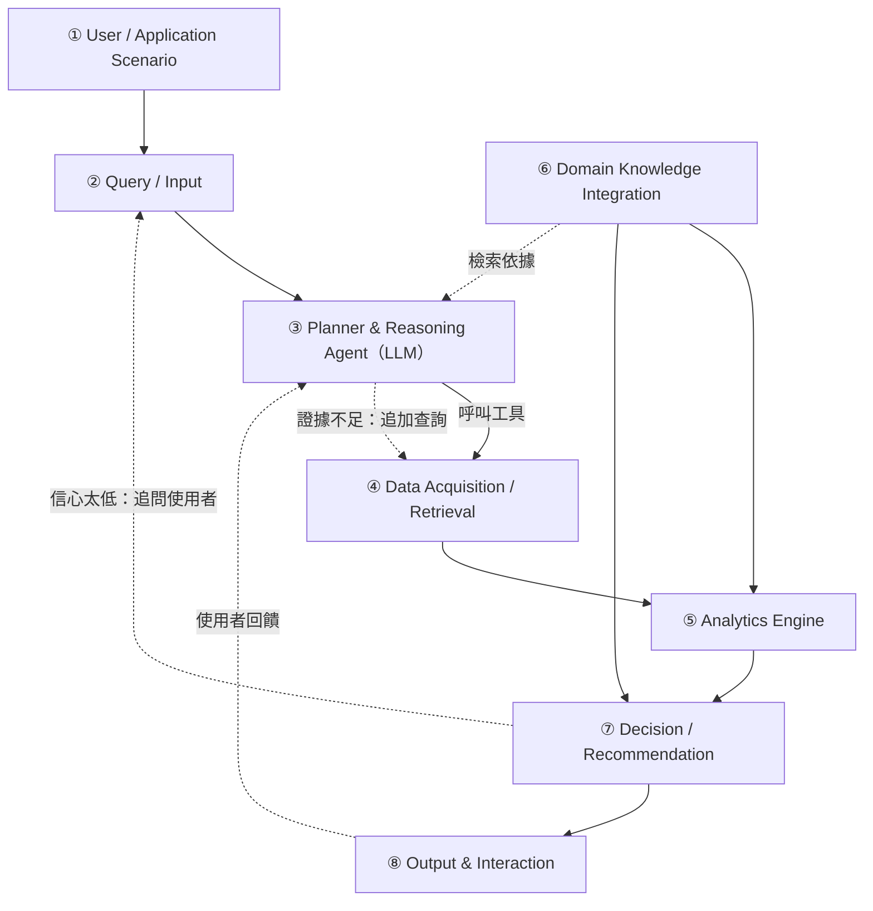
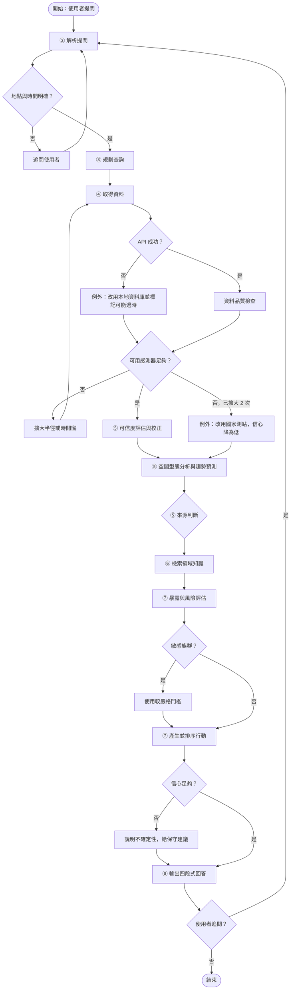

# AirSleuth 空品偵探：結合 IoT 微型感測器與領域知識的空氣品質 Domain AI Agent

**物聯網數據分析與應用｜期末專題提案（Final Project Proposal）**

組員：陳宏郁、陳彥愷、王鼎昌、李家豐、周聖儒｜繳交日期：2026 年 11 月 4 日

GitHub：https://github.com/A0966411725-png/AirSleuth

> 本文件由 `proposal/00～05` 各章合併產生（`python scripts/build_proposal.py`）。文中 [S-xxx] 對應第 5 章參考文獻；標 🟡 者僅確認書目，數字需再核對原文。

## 目錄

- 摘要（Abstract）
- 1. 緒論（Introduction）
- 2. 相關研究（Related Work）
- 3. 深度研究（Deep Research）
- 4. 系統設計（Proposed Scheme）
- 5. 參考文獻（References）

---

## 摘要（Abstract）

**AirSleuth 空品偵探：結合 IoT 微型感測器與領域知識的空氣品質 Domain AI Agent**

**(A) Attention Getter｜研究動機**　2025 年台灣全國 PM2.5 年平均為 12.8 μg/m³，仍未達到 2030 年的新標準 12 μg/m³，是世界衛生組織指引值的 2.5 倍；而短期暴露每增加 10 μg/m³，死亡風險就增加約 0.65%。與此同時，台灣已有約 1.1 萬個公開的微型空品感測器，約每分鐘回傳一次資料。

**(B) But｜挑戰**　然而，民眾拿到的仍只是數字與顏色。現有服務不會告訴使用者污染是附近的局部來源還是整個區域受到影響，不會依個人的時間、地點與活動給出具體建議，也不會說明微型感測器的讀數有多可信；研究顯示，空品不佳時照建議調整活動的民眾比例中位數只有 31%。近年的大型語言模型（LLM）空品系統能查詢與呈現資料，但不判斷原因；感測器校正與預測模型越來越準，卻沒有接到個人的決策流程。

**(C) Cure｜解決方案**　為了解決上述問題，本專題提出一個新的空氣品質 Domain AI Agent：**AirSleuth**。

**(D) Development｜方法**　AirSleuth 以 LLM 負責規劃、推理與表達，以確定性的程式負責所有計算：④ 串接民生公共物聯網的微型感測器、國家測站與氣象資料，並先進行資料品質檢查；⑤ 以「區域背景、局部超量、空間一致性」判斷污染屬於局部型或區域型事件，並預測未來數小時的趨勢；⑥ 整合 2025 年新版 AQI、敏感族群建議，以及從 52 筆經查核文獻歸納的專家核心觀念；⑦ 依使用者的族群、時段、地點與活動強度，產生具體行動並評估信心程度。回答中的每個數字都必須能追溯到資料查詢的結果。

**(E) Experiments｜評估**　本專題以 Windows 排程持續收集臺中市、高雄市的微型感測器資料作為資料集，選取區域型與局部型的真實事件作為案例研究；以「只看 AQI 的現有做法」、「沒有工具的純 LLM」、「有工具但沒有領域知識與品質檢查的 LLM」作為基準，評估來源判斷與人工標記的一致率、預測誤差、回答數字可追溯的比例，以及建議的具體程度與正確性。

**(F) Findings｜預期成果**　預期 AirSleuth 能額外回答現有服務無法回答的「為什麼」與「我該怎麼做」，回答中的數字都能追溯到資料來源，並在明顯的區域型與局部型事件上與人工判斷一致；混合型事件與感測器稀疏地區的判斷可能較不穩定，將在研究限制中說明。（本段為預期成果，非實驗結果。）

**關鍵字：**Domain AI Agent、大型語言模型、物聯網、低成本感測器、PM2.5、污染來源判斷、健康風險溝通

---

## 1. 緒論（Introduction）

### A. Attention Getter：資料已經在那裡，民眾卻只拿到一個顏色

2025 年，台灣全國 PM2.5 年平均濃度為 12.8 μg/m³ [S-022]。這個數字比七年前改善了 21%，但仍未達到環境部 2024 年加嚴、預定 2030 年達成的新標準 12 μg/m³ [S-016]，更是世界衛生組織 2021 年指引值 5 μg/m³ 的 2.5 倍 [S-020]；中南部的平均更高達 14.8 μg/m³ [S-022]。

同一時間，台灣已經建立大規模、資料公開的空品感測網：民生公共物聯網上登記了約 1.1 萬個環境部微型感測器，約每分鐘回傳一次 PM2.5、溫度與濕度 [S-001]。

然而，一位想知道「明天下午能不能帶小孩去公園」的家長，打開空品 App 看到的，仍然只是一個數字和一個顏色。

### B. Background：空品資訊服務的現況

PM2.5 的健康影響不只發生在長期暴露。統合分析顯示，數小時到數天的短期暴露每增加 10 μg/m³，死亡風險就增加約 0.65% [S-027]；空污也會增加氣喘急診與住院，兒童與長者的效應更強 [S-031]。台灣的本土研究也發現，PM2.5 最高的鄉鎮，五歲以下兒童的死亡風險是最低組的 1.12 倍 [S-024]。

為了保護民眾，台灣以空氣品質指標（AQI）分級發布空品資訊：2025 年起，「良好」的 PM2.5 上限從 15.4 下修為 12.4 μg/m³ [S-029]，各等級再依「一般民眾」與「敏感族群」提供活動建議 [S-032]。資料端則有國家空品測站、微型感測器與氣象站三類來源，分別發布在不同的平台上。

### C. Problem：民眾真正想問的三個問題，現有服務都沒有回答

1. **為什麼？**同樣是 PM2.5 偏高，可能是附近在施工或燃燒（局部來源），也可能是整個區域受到傳輸影響（區域事件）。兩者的應對方式完全不同：局部污染換個地方就能避開，區域事件則整個城市都一樣。現有服務只顯示濃度，不做這個判斷。
2. **我該怎麼做？**現行建議只依族群分類，沒有結合使用者的時間、地點與活動。研究顯示，空品不佳時，實際照建議調整戶外活動的比例中位數只有 31%，主要阻礙之一就是看不懂指標 [S-028]。
3. **這個數字可信嗎？**微型感測器的原始讀數會系統性高估約 40%，濕度越高誤差越大 [S-008、S-009]；本專題實測也發現，臺中市約 41% 的微型感測器有時回報濕度為 0（T-07）。環境部也指出，國外報告因為納入低成本感測器，數字和官方統計有落差 [S-022]。民眾同時看到好幾種數字，卻不知道該相信哪一個。

### D. Existing Limitations：現有方法的不足

- **LLM 空品系統只會「查」和「畫」。**近年的研究讓 LLM 透過工具查詢即時空品資料、產生分析程式 [S-036、S-037]，降低了幻覺，但都沒有判斷污染原因，也沒有處理感測器資料的品質問題。
- **校正與預測模型沒有接到決策。**機器學習已能把感測器誤差大幅降低 [S-041、S-043]、把預測做得更準 [S-049]，但這些都是獨立的模型，產出的是「更準的數字」，而不是「給個人的判斷」。
- **來源判斷的方法停留在研究階段。**扣除區域背景來找局部熱點的方法已經存在 [S-045、S-047]，但都是離線產出地圖或論文，沒有即時轉成民眾看得懂的解釋。
- **現有的 LLM 個人化警示只限室內**[S-038]，沒有處理室外污染的來源判斷。

### E. Innovation：AirSleuth 和現有方法有什麼不同

本專題提出 **AirSleuth 空品偵探**：一個結合 IoT 微型感測器與領域知識的空氣品質 Domain AI Agent。它和現有方法的差異在於：

| 現有做法 | AirSleuth |
|---|---|
| 顯示濃度與 AQI 顏色 | **判斷原因**：依當下的空間型態，判斷是局部型、區域型或混合型事件 |
| 直接採用感測器讀數 | **先檢查資料品質**，依濕度、完整度與鄰近一致性評估可信度 |
| 依族群給一般性建議 | **依使用者的時間、地點、活動強度**給出具體行動，並考慮運動的好處 [S-033] |
| LLM 自由生成回答 | **所有數字都來自工具查詢**，每個結論附上證據與信心程度 |

最關鍵的差異是：**判斷來源會直接改變建議**。如果是局部污染，「換個地方運動」就是有效的建議；如果是區域事件，換地方沒有用，應該改時段或改到室內。只看 AQI 的工具無法做出這種區分。

### F. Contributions：本專題的預期貢獻

1. **一個可運作的 Domain AI Agent 架構**（①～⑧ 模組），把 LLM 的推理能力和確定性的分析程式結合：LLM 負責規劃與表達，數字與判斷由程式產生，結果可以重現與驗證。
2. **一個以空間型態判斷污染來源的方法**，建立在台灣公開的微型感測網上，並以真實事件案例驗證。
3. **一套考慮資料品質的分析流程**，包括已實作的資料串接、排程收集與品質檢查（T-07），以及對台灣微型感測器資料品質的實測分析。
4. **一個以證據為基礎的領域知識庫**：52 筆經查核的文獻、8 個專家核心觀念、3 個專業爭議的整理，可以重複使用在其他空品應用上。

---

## 2. 相關研究（Related Work）

本章依作業規範，分成約一半的 **AI 技術**（2.1）與一半的**領域知識**（2.2），以 Article Summary Table 對照（2.3），最後歸納出研究缺口（2.4）。

### 2.1 AI 技術

#### 2.1.1 以大型語言模型為核心的 Agent

大型語言模型（Large Language Model, LLM）單獨使用時容易產生幻覺。ReAct [S-035] 讓 LLM 交錯產生「推理軌跡」與「行動」，透過呼叫外部工具取得資訊再修正計畫，在問答與事實查核任務上減少了錯誤傳遞，推理過程也更容易被人理解。這個「先想要查什麼、查完再判斷」的模式，是近年 Agent 系統的基礎。

在空品領域，Pan 與 Nipu [S-036] 透過 Model Context Protocol（MCP）把空品監測系統的功能包裝成工具，讓 LLM 主動查詢即時感測器資料後再回答，專家評分的事實正確性達 4.78／5。VayuChat [S-037] 讓使用者以自然語言提問，由 LLM 產生可執行的 Python 程式碼，分析印度國家測站資料與政策經費。EnQyMo [S-038] 則更進一步，由多個 LLM 組成的代理解讀法規與文獻、找出健康暴露門檻，並結合 IoT 與室內定位，只通知待在污染空間裡的人。在空品以外，JARVIS [S-039] 以「規劃 LLM ＋ 執行 SQL 與統計的代理」兩階段架構，回答空調系統的感測器資料問題，並依情境注入領域知識。綜述研究 [S-040] 也指出，LLM 在都市環境監測上的應用仍面臨泛化與情境理解的限制。

**小結：**LLM 已經能可靠地「查詢」與「呈現」空品資料，但現有系統著重在資料存取與視覺化，**沒有判斷污染來源，也很少處理感測器資料本身的品質**；以個人化健康警示為目標的研究 [S-038] 則只限於室內。

#### 2.1.2 低成本感測器的資料校正

低成本感測器的原始讀數有系統性偏差。美國全國規模的研究 [S-008] 發現 PurpleAir 感測器在多數地區高估約 40%，加入相對濕度的迴歸可以大幅改善；在潮濕地區，濕度與 PM2.5 的關係在相對濕度約 50% 以上呈非線性 [S-009]；而且同一個校正模型在不同地點的表現不同 [S-010]。

機器學習校正的效果普遍優於線性方法。在台灣，Wang 等人 [S-041] 以國家測站資料校正 39 個感測器，隨機森林的 RMSE 從 18.4 降到 5.9 μg/m³；Lee 等人 [S-011] 以廣義加成模型處理偏差的時空結構，並量化每個讀數的不確定性。近期研究比較隨機森林、XGBoost 與混合模型，RMSE 可比線性迴歸降低 58%～63% [S-043]；以 LSTM 捕捉時間依賴的方法，校正後的 PM2.5 擴展不確定度可降到 9.1% [S-044]。

**小結：**校正方法已相當成熟，但這些研究產出的是「更準的數字」，**沒有把資料可信度傳達給使用者，也沒有接到決策流程裡**。

#### 2.1.3 資料驅動的污染來源判斷

要知道污染從哪裡來，傳統方法是化學成分分析或空品模式（見 2.2.2）。在密集感測網上，則發展出依時空型態判斷的方法。Jain 等人 [S-045] 用小波分解把短期局部事件從區域背景中分離，分離時間尺度後，土地利用模型的 R² 最多再提升 0.14；Perry 等人 [S-047] 先扣除背景濃度，再以高斯過程迴歸計算具機率意義的「熱點分數」；Bashan 等人 [S-046] 以測站之間的時間延遲相關建立動態網路，對野火煙霧等區域性事件很敏感。在台灣，研究級感測器的長期監測也證實，街道層級的熱點靠近交通、廟宇與市場，並隨時間移動 [S-014]。

**小結：**「先扣掉區域背景，剩下的才是局部」已經是可行的概念，但這些方法都是**離線研究工具**，產出地圖或論文結論，**沒有即時轉成一般民眾看得懂的解釋**。

#### 2.1.4 PM2.5 短期預測

PM2.5 預測已從統計模型發展到時空圖神經網路（Graph Neural Network, GNN）。在台灣，Su 等人 [S-048 🟡] 以測站為節點，結合 GNN 與 GRU 預測未來 48 小時，包含沒有測站的地區；Chen 等人 [S-051] 以卷積遞迴網路處理大規模感測網資料，產生預測地圖。近期的多尺度動態圖神經網路同時建模小時、日、週三種時間尺度，誤差比最佳基準再降低 6.77%～8.67% [S-049]。

**小結：**預測模型越來越準，但也越來越複雜、越難解釋；本專題的重點不在追求最準的預測，而是**把預測放進可解釋的決策流程**，因此以多元線性迴歸作為可解釋的基準模型。

### 2.2 領域知識

#### 2.2.1 PM2.5 的健康影響與敏感族群

短期暴露（一小時到數天）就有健康效應。196 篇研究的統合分析 [S-027] 顯示，PM2.5 每增加 10 μg/m³，全死因死亡風險增加約 0.65%，證據確定性為高。空污也增加氣喘急診與住院，兒童與長者的效應較強，並有延遲 2 天以上的效應 [S-031]。長期暴露方面，即使濃度低於當時的美國標準，死亡風險仍持續上升 [S-021]，這是 WHO 在 2021 年把年平均指引值由 10 下修為 5 μg/m³ 的依據之一 [S-020]。

台灣的本土研究也有一致的發現：PM2.5 最高的鄉鎮，五歲以下兒童的死亡風險是最低組的 1.12 倍 [S-024]；高雄林園工業區居民的死亡率持續高於全台平均 [S-025]；而全台 PM2.5 下降，自然死因死亡率也跟著下降 [S-026]。

#### 2.2.2 台灣 PM2.5 的來源

台灣 PM2.5 的來源是長期的爭議（詳見 Deep Research Q2）。環保署估計全國年平均約 34%～40% 來自境外、60%～66% 來自境內 [S-002]；模式研究顯示，中國兩大工業區在 2017 年 1 月約貢獻台灣 PM2.5 的 5% 與 7.5%，7 月則可忽略 [S-004]；但受體模式研究發現，南台灣的高污染事件主要來自本地排放 [S-005]。差異主要來自研究方法、季節、地點與時間尺度。**共識是：境外傳輸存在且有季節性，但沒有單一正確的比例。**

#### 2.2.3 低成本感測器的角色

台灣已有大規模的感測網。環保署規劃全國布建 10,200 個感測器 [S-013]，目前民生公共物聯網上登記了約 1.1 萬個 [S-001]；早期的 AirBox 計畫也在台灣與 29 國部署了超過 2,500 台裝置 [S-012]。不過環境部也指出，感測器「易受環境條件與設備品質影響」，官方統計以標準方法為準 [S-022]。**共識是：微型感測器不能取代標準測站做法規判定，但經過校正後，很適合看空間分布、找出熱點。**

#### 2.2.4 健康指引與民眾行為

台灣在 2024 年把 PM2.5 標準由年平均 15、日平均 35 加嚴為 12 與 30 μg/m³，2030 年達標 [S-016]；2025 年起，AQI「良好」的 PM2.5 上限由 15.4 降為 12.4 μg/m³ [S-029]。現行的活動建議依「一般民眾」與「敏感族群」兩類分別提供 [S-032]。

然而，給出指引不等於民眾會照做。21 篇研究的系統性回顧發現，空品不佳時，實際減少或調整戶外活動的比例中位數只有 31%，主要阻礙之一就是**看不懂指標** [S-028]；警示天數越多，民眾越有意識，但改變行為的仍是少數 [S-030]。此外，在一般的都市濃度下，運動的健康效益遠大於空污的風險 [S-033]，所以「空氣不好就別運動」並不是好建議。人們平均有 87% 的時間待在室內 [S-034]，暴露量取決於在哪裡、待多久、做什麼，而不只是戶外濃度。

### 2.3 Article Summary Table

| Ref | Year | Problem | AI Method | Domain Knowledge | Dataset | Findings | Limitation |
|---|---|---|---|---|---|---|---|
| [S-035] | 2022 | LLM 推理與行動分離、易幻覺 | ReAct：推理與工具呼叫交錯 | — | HotpotQA、FEVER 等 | 減少幻覺，軌跡可解釋 | 通用工具，無領域知識 |
| [S-036] | 2025 | 空品系統難懂、LLM 會幻覺 | LLM + MCP 工具呼叫 | 有限 | 即時感測器 | 事實正確性 4.78／5 | 不判斷來源、不處理資料品質 |
| [S-037] | 2025 | 空品資料難以轉成決策 | LLM 產生分析程式碼 | 測站、政策經費 | 印度 CPCB 測站 | 對話式分析已部署 | 對象是決策者，無微型感測器 |
| [S-038] | 2026 | 室內空品監測被動 | 多 LLM 代理 + IoT + 定位 | 室內法規、健康門檻 | 室內感測器 | 依位置的個人化警示 | 只限室內 |
| [S-041] | 2020 | 感測器缺乏校正 | 隨機森林、SVR、MLR | 日夜偏差型態 | 台灣 39 個感測器 | RMSE 18.4 → 5.9 μg/m³ | 少量、單一型號 |
| [S-043] | 2026 | ML 校正在各種條件下的表現 | RF、XGBoost、混合模型 | 溫濕度、時段影響 | 印度長期共置 | RMSE 降低 58%～63% | 單一地點 |
| [S-045] | 2021 | 感測網的高解析污染地圖 | 隨機森林土地利用模型 + 小波分解 | 區域背景 + 局部來源 | 匹茲堡 50 站 | 分離時間尺度後 R² 最多 +0.14 | 日平均，非即時 |
| [S-047] | 2025 | 都市熱點辨識 | 背景正規化 + 高斯過程 | 背景 vs 熱點 | 基加利行動感測 | 熱點分數符合真實分布 | 產出地圖，非個人建議 |
| [S-049] | 2025 | 多時間尺度 PM2.5 預測 | 動態 GNN + 注意力 | 測站時空相依 | 長株潭 22 站 | 誤差降低 6.77%～8.67% | 只用測站，可解釋性低 |
| [S-008] | 2021 | 低成本感測器的全國性偏差 | 線性與多元迴歸 | 粒子吸濕成長 | 美國 16 州約 12,000 筆 | 原始讀數高估約 40% | 單一型號 |
| [S-011] | 2019 | 台灣感測網的校正 | 廣義加成模型 | 偏差的時空結構 | 台灣感測器與測站 | R² 0.76，量化不確定性 | 單一型號 |
| [S-004] | 2020 | 中國工業區對台灣的貢獻 | 空品模式（WRF-CMAQ） | 長程傳輸、季風 | 2017 年 1 月、7 月 | 冬季約 5% + 7.5%，夏季可忽略 | 只模擬兩個月 |
| [S-005] | 2019 | 南台灣高污染事件來源 | 受體模式（CMB） | 化學指紋 | 高屏事件採樣 | 以本地排放為主 | 只限事件期間 |
| [S-027] | 2020 | 短期暴露與死亡 | 統合分析 | 短期效應 | 196 篇研究 | 每 10 μg/m³ 死亡 RR 1.0065 | 部分組合異質性高 |
| [S-024] | 2025 | 台灣兒童死亡風險 | 加權多元迴歸 | 兒童是敏感族群 | 65 鄉鎮 2013–2022 | 最高組 RR 1.12 | 生態研究 |
| [S-028] | 2017 | 民眾是否遵從空品警示 | 系統性回顧 | 風險溝通、行為改變 | 21 篇研究 | 遵從率中位數 31% | 以歐美為主 |
| [S-033] | 2016 | 運動效益 vs 空污風險 | 風險效益模型 | 劑量反應、活動量 | 情境模擬 | 一般濃度下運動效益遠大於風險 | 長期平均，非急性 |

（AI 技術 9 篇、領域知識 8 篇。完整的 52 筆來源見 `research/sources.md`。）

### 2.4 Existing Research → Limitations → Research Gap → Our Project

#### Existing Research：現有研究做到了什麼
1. **LLM Agent** 已能透過工具呼叫查詢即時空品資料、產生分析，並降低幻覺 [S-035、S-036、S-037]。
2. **感測器校正與預測模型**越來越準，台灣也有本土研究 [S-011、S-041、S-048、S-049、S-051]。
3. **局部 vs 區域的分離方法**已經存在 [S-045、S-046、S-047]。
4. **健康研究**清楚指出短期暴露的風險、敏感族群的差異，以及「沒有安全閾值」[S-020、S-021、S-024、S-027、S-031]。

#### Limitations：還有哪些不足
1. LLM 空品系統**只會「查」和「畫」**，不會判斷污染的原因 [S-036、S-037]。
2. 校正與預測是**獨立的模型**，沒有把資料可信度傳達給使用者 [S-041、S-043、S-049]。
3. 來源判斷方法是**離線研究工具**，沒有即時、口語化的解釋 [S-045、S-047]。
4. 健康指引**只依族群分類**，沒有結合個人的時間、地點與活動；只給數字時，民眾遵從率偏低 [S-028、S-032]。

#### Research Gap：研究缺口
> 現有研究分成兩群：「**LLM 讓空品資料好查**」與「**機器學習讓感測器和預測更準**」。**還沒有一個系統把兩者接起來**：在台灣大規模的公開微型感測網上，**判斷污染是局部還是區域、說明資料有多可信，並依使用者情境給出具體行動建議**。

#### Our Project：AirSleuth 怎麼補上這個缺口

| 缺口 | AirSleuth 的做法 | 對應模組 |
|---|---|---|
| 不會判斷原因 | 扣除區域背景，計算局部超量與空間一致性，判斷局部型或區域型 | ⑤ |
| 不說明資料可信度 | 先做品質檢查與可信度評估，輸出時附上信心程度 | ④⑤⑦ |
| 研究工具沒有即時解釋 | LLM Agent 以自然語言說明判斷依據與證據 | ③⑧ |
| 建議不夠個人化 | 結合族群、時段、地點、活動強度與運動取捨，給出具體行動 | ⑥⑦ |

---

## 3. 深度研究（Deep Research）

### Q1. 五個核心思維模式

> 這個領域的專家普遍認同的五個核心思維模式是什麼？每項說明意義、證據，以及如何影響系統設計。

#### 思維 1：濃度不等於暴露量

- **意義：**真正影響健康的是「吸進去多少」，取決於**在哪裡、待多久、做什麼**。戶外 PM2.5 很高，但一直待在門窗緊閉、開著清淨機的室內，暴露量不一定高；反過來，戶外數值普通，但騎車通勤一小時、經過工業區，暴露量可能很可觀。
- **證據：**美國全國人類活動型態調查（NHAPS）發現，受訪者平均 87% 的時間待在室內 [S-034]。運動時的呼吸量明顯增加，因此同樣的濃度、不同的活動強度，吸入量不同 [S-033]。
- **對系統設計的影響：**② 輸入時要問清楚使用者的**時段、地點、活動與停留時間**；⑦ 用「濃度 × 時間 × 呼吸量」估算暴露，而不是只看戶外濃度。

#### 思維 2：沒有安全閾值，短時間的高峰也有健康意義

- **意義：**PM2.5 沒有「低於多少就完全無害」的門檻；而且不只長期平均重要，數小時到數天的短期高峰也會造成健康影響。
- **證據：**低於當時美國標準的濃度下，長期暴露仍與死亡風險上升有關 [S-021]，WHO 因此把年平均指引值由 10 下修為 5 μg/m³ [S-020]；短期暴露每增加 10 μg/m³，死亡風險增加約 0.65% [S-027]；氣喘急診的增加有延遲 2 天以上的效應 [S-031]。
- **對系統設計的影響：**⑤ 預測要做到**小時層級**，而不只是日平均；⑦ 即使是 AQI 綠燈，也要對心肺疾病患者提供提醒；⑧ 提醒使用者症狀可能延遲出現。

#### 思維 3：先問資料可不可信，再談數值多少

- **意義：**低成本感測器適合看**空間分布與相對變化**，但絕對數值有系統性誤差，尤其在高濕度時；判斷前必須先確認資料品質。
- **證據：**PurpleAir 的原始讀數在美國多數地區高估約 40% [S-008]；相對濕度約 50% 以上時，誤差呈非線性 [S-009]；同一個校正模型在不同地點表現不同 [S-010]；環境部也指出感測器「易受環境條件與設備品質影響」[S-022]。本專題實測發現，臺中市約 41% 的感測器有時回報濕度為 0、少數感測器數值連續 1 小時不變（T-07）。
- **對系統設計的影響：**④ 所有資料先經過品質檢查（已實作 `src/data/quality.py`）；⑤ 依濕度、完整度與鄰近一致性評估可信度，有國家測站時用測站校正；⑦⑧ 輸出時附上信心程度。

#### 思維 4：天氣與空間型態，決定污染是局部還是區域

- **意義：**同樣的排放量，風小、不下雨時濃度就會累積；而「只有一處高」和「整片一起高」代表完全不同的成因。判斷成因要看**空間型態與氣象**，而不是只看單一測點的數字。
- **證據：**2024 年 PM2.5 改善，環境部表示部分歸功於下半年降雨較多 [S-023]；中國工業區對台灣的影響集中在冬季東北季風期間，夏季幾乎可以忽略 [S-004]；扣除區域背景後分析局部事件，能大幅提升污染地圖的解釋力 [S-045]。
- **對系統設計的影響：**⑤ 計算**區域背景、局部超量與空間一致性**來判斷來源（Algorithm 2），並納入風向與季節；⑦ 依來源類型決定建議（局部型才建議換地點）。

#### 思維 5：健康建議是「取捨」，不是「禁止」

- **意義：**好的建議要依對象調整、權衡活動的好處，而且要具體可行動。「空氣不好就待在家」對多數人來說，既不必要，也不會被遵守。
- **證據：**兒童、長者與氣喘患者的風險較高 [S-024、S-031]；一般都市濃度下，運動的健康效益遠大於空污的風險 [S-033]；空品不佳時，照建議調整戶外活動的比例中位數只有 31%，看不懂指標是主要阻礙之一 [S-028]。
- **對系統設計的影響：**⑦ 敏感族群提前一級警示；候選行動包含「改時段、改地點、降強度」，而不只是「取消」；⑧ 用固定的四段式回答（結論、原因、建議、信心），讓建議具體可行。

#### 五個思維與架構的對應

| 思維 | ② 輸入 | ④ 資料 | ⑤ 分析 | ⑥ 知識 | ⑦ 決策 | ⑧ 輸出 |
|---|---|---|---|---|---|---|
| 1 濃度 ≠ 暴露 | ✔ | | | ✔ | ✔ | |
| 2 沒有安全閾值 | | | ✔ | ✔ | ✔ | ✔ |
| 3 資料可信度 | | ✔ | ✔ | | ✔ | ✔ |
| 4 天氣與空間型態 | | ✔ | ✔ | ✔ | ✔ | |
| 5 取捨而非禁止 | ✔ | | | ✔ | ✔ | ✔ |

---

### Q2. 三個最重要的專業爭論

> 這個領域專家爭論最激烈的三個問題是什麼？雙方最有力的證據是什麼？目前共識是什麼？還有哪些問題尚未解決？

#### 爭論 1：台灣的 PM2.5，主要來自境外還是本地？

| | 觀點 A：境外傳輸影響很大 | 觀點 B：本地排放才是主因 |
|---|---|---|
| **主張** | 秋冬季東北季風把上游污染帶進台灣，北部、東部與外島受影響更大 | 全年平均來說，本地排放佔多數；南部的高污染事件主要來自本地 |
| **證據** | 環保署估計全國年平均約 34%～40% 來自境外 [S-002]；模式研究顯示 2017 年 1 月中國兩大工業區合計約貢獻 12.5% [S-004]；台北約 25% 來自長程傳輸 [S-003]；外島的跨境比例更高 [S-007 🟡] | 同一份估計也顯示境內約佔 60%～66% [S-002]；南台灣高污染事件的化學指紋顯示，人為排放佔 67%～70%，以本地為主 [S-005]；夏季境外影響幾乎可以忽略 [S-004] |

- **Evidence 的差異從哪裡來：**① 研究方法不同：空品模式從排放端推算，受體模式從化學指紋反推；② 時間尺度不同：全年平均、單一事件、特定天氣型態的結論可能完全不同；③ 地點與季節不同；④ 排放清冊的年份不同。
- **Consensus：**境外傳輸**存在且有季節性**，但全年全國平均以本地排放為主；**沒有單一正確的比例**。
- **Unresolved Problems：**缺乏一致方法、跨年度的官方比較；衍生性氣膠（如硝酸鹽）的前驅物在哪裡排放，歸屬仍不確定；民眾**此時此刻**遇到的是哪一種，目前沒有即時工具可以判斷。
- **對 AirSleuth 的啟示：**不引用「境外佔 X%」這種單一數字，而是依**當下的空間型態**判斷是局部還是區域事件，並說明**無法確定區域污染究竟來自境外還是國內其他地區**（見 DESIGN.md Limitations）。

#### 爭論 2：低成本微型感測器的資料，能不能拿來做決策？

| | 觀點 A：校正後可以用，而且很有價值 | 觀點 B：誤差太大，不能取代標準測站 |
|---|---|---|
| **主張** | 微型感測器的高密度，能看到測站看不到的局部熱點；校正後誤差可以大幅降低 | 原始讀數有系統性高估，高濕度時更嚴重；不同地點需要不同校正，沒有通用解 |
| **證據** | 台灣感測網的時空校正可解釋偏差 R² 0.76，並能量化不確定性 [S-011]；隨機森林把 RMSE 從 18.4 降到 5.9 μg/m³ [S-041]；社區監測發現靠近交通、廟宇、市場的熱點 [S-014] | 原始讀數在美國多數地區高估約 40% [S-008]；相對濕度約 50% 以上時呈非線性 [S-009]；校正模型的表現因地而異 [S-010]；環境部指出感測器易受環境與設備影響，官方統計以標準方法為準 [S-022] |

- **Evidence 的差異從哪裡來：**① **用途不同**：找熱點、看相對變化對準確度要求低；法規判定、絕對數值要求高；② 有沒有校正；③ 濕度條件；④ 感測器等級（研究級 vs 一般商用）。
- **Consensus：**微型感測器**不能取代標準測站做法規判定**，但經過校正後，**很適合看空間分布、找熱點與異常事件**；濕度校正是必要的，讀數應附上不確定性。
- **Unresolved Problems：**不同地點與氣膠組成需要不同的校正模型；感測器老化造成的漂移需要持續重新校正；本專題實測發現**連校正需要的濕度資料本身都常無效**（T-07）。
- **對 AirSleuth 的啟示：**微型感測器用來判斷**空間型態**（相對變化），健康建議的濃度門檻以校正後或測站數值為準；濕度高或資料品質差時降低信心並告知使用者。

#### 爭論 3：PM2.5 標準和健康建議，應該訂多嚴？

| | 觀點 A：應該更嚴，朝 WHO 指引值靠攏 | 觀點 B：依國情分階段加嚴，兼顧可行性 |
|---|---|---|
| **主張** | 低濃度仍有健康風險，台灣人口密度高，標準不應比美國寬鬆 | 減量成本與健康效益需要權衡；境外傳輸與地區差異讓過嚴的標準難以達成 |
| **證據** | 低於標準的濃度下死亡風險仍上升 [S-021]；WHO 指引值 5 μg/m³ [S-020]；美國 2024 年已加嚴到 9 μg/m³ [S-019]；環團認為台灣新標準 12 與美國「還是有點距離」[S-017] | 國衛院研究指出年平均降到 12.5 μg/m³ 時，減量成本與疾病損失可達權衡 [S-018]；環境部表示台灣人口與車輛密度遠高於美國，暫時無法降到 10 以下 [S-017]；新標準採分階段逼近 WHO 最終建議值 [S-016] |

- **Evidence 的差異從哪裡來：**① **價值取捨**：純健康觀點（任何濃度都有風險）vs 成本效益觀點；② 證據來源：國際大型世代研究 vs 本土成本效益分析；③ 可控程度：境外傳輸的部分無法靠本地減量（連回爭論 1）。
- **Consensus：**PM2.5 **沒有安全閾值**，雙方都接受；台灣的方向是**分階段加嚴**：2024 年由 15 加嚴為 12，介於 WHO 暫行目標 3（15）與 4（10）之間，長期朝 5 邁進。
- **Unresolved Problems：**下一階段加嚴到多少、何時加嚴，還沒有時間表；新 AQI 上路後綠燈比率估計由 55% 降到 40%、黃燈由 37% 升到 50% [S-017]，燈號變多之後，民眾會更注意還是產生警示疲乏，仍待觀察。
- **對 AirSleuth 的啟示：**健康門檻以台灣 2025 年新版 AQI 為主，同時讓使用者知道 WHO 的建議值；敏感族群使用較嚴格的門檻；為了避免警示疲乏，建議必須**具體、可行動**。

---

### Q3. 十個深度理解問題

> 設計 10 個問題，用來判斷一個人是真正深入了解這個領域，還是只有死記硬背。
> 每題附上「真正理解的回答要點」與「只會背的人常見的回答」，方便口頭報告前練習。

| # | 類型 | 問題 | 真正理解的回答要點 | 只會背的人常見的回答 |
|---|---|---|---|---|
| 1 | **Why** | 為什麼 PM2.5 比 PM10 更受重視？ | WHO 指出室外空污造成的過早死亡，主要來自細懸浮微粒引起的心血管與呼吸系統疾病，約 68% 是缺血性心臟病與中風 [S-052]；短期暴露也和心血管、呼吸、腦血管死亡有關 [S-027]；所以健康指引與標準以 PM2.5 為核心 | 「因為比較小」，說不出和健康結果的關係 |
| 2 | **Why** | 為什麼同一個地點，微型感測器和國家測站的數字會不一樣？ | 量測原理不同（光散射 vs 標準方法）；高濕度時粒子吸濕膨脹造成高估 [S-008、S-009]；位置、高度、維護狀況不同；兩者的用途不同 [S-022] | 「感測器比較便宜所以不準」 |
| 3 | **What-if** | 如果整個臺中市的感測器都同時升高，而附近一個工廠的感測器沒有特別高，你會怎麼判斷？ | 空間一致性高、局部超量小 → 區域型事件；要看風向與季節，冬季東北風時可能有長程傳輸；**不能據此推論工廠沒有排放**，只能說它不是這次升高的主因 | 「工廠沒問題」或「是中國吹過來的」 |
| 4 | **What-if** | 如果某一個感測器突然飆到 300 μg/m³，周圍的感測器都正常，Agent 應該怎麼處理？ | 先懷疑感測器異常（濕度、故障、近距離干擾，例如有人在旁邊燒香或抽菸）；檢查鄰近感測器、資料品質旗標與持續時間；只有多個鄰近感測器一起升高才判定為局部污染（Algorithm 2 第 12～14 行） | 「附近有嚴重污染，立刻發警報」 |
| 5 | **Trade-off** | AQI 黃燈時，一位有運動習慣的健康成人該不該取消晚上的慢跑？ | 一般都市濃度下，運動的好處遠大於空污的風險 [S-033]；可以調整時段、路線（避開主要道路）或強度，而不是直接取消；若有呼吸道症狀或屬於敏感族群，再提高警覺 | 「空氣不好就不要運動」 |
| 6 | **Trade-off** | 空品警示門檻訂得越嚴越好嗎？ | 越嚴保護力越高，但警示天數變多可能造成警示疲乏 [S-017]；民眾遵從率本來就偏低 [S-028]；所以重點在建議是否具體可行，而不只是門檻高低 | 「越嚴越安全」 |
| 7 | **Failure Case** | 用「空間型態」判斷局部或區域，在什麼情況下會判斷錯？ | 感測器太稀疏（郊區、山區）；大範圍的局部污染同時發生（例如農地大面積燃燒）會看起來像區域事件；海陸風、地形造成的累積；濕度造成多個感測器同時高估；而且它**無法分辨區域污染來自境外還是國內其他地區** | 「資料不夠多的時候」，說不出具體情境 |
| 8 | **Evidence** | 「台灣 PM2.5 有四成來自中國」這句話對嗎？你會怎麼回應？ | 環保署估計境外約 34%～40%，是**全國年平均**的模擬結果 [S-002]；冬季較高、夏季很低 [S-004]，南部高污染事件以本地為主 [S-005]；境外也不等於全部來自中國；結論取決於方法、季節與地點 | 直接說「對」或「不對」 |
| 9 | **Comparison** | AirSleuth 和一般的空品 App、和 ChatGPT 直接回答，差在哪裡？ | 空品 App 只給數字與顏色，不判斷原因、不個人化；純 LLM 沒有即時資料，容易捏造數字 [S-035]；AirSleuth 的數字全部來自工具查詢，會判斷來源、評估資料可信度，並依使用者情境給建議 | 「AirSleuth 有用 AI」 |
| 10 | **Design Decision / Real-world Scenario** | 一位氣喘孩童的家長下午 2 點問：「4 點可以去公園嗎？」Agent 需要哪些資訊、做哪些判斷，才能負責任地回答？ | 需要：公園位置、孩童屬於敏感族群、預計活動與時間；判斷：附近感測器的資料品質、局部或區域型、4 點的預測與信心程度、新版 AQI 的敏感族群門檻；回答：具體建議（例如改到 5 點、避開主要道路、攜帶吸入劑），並說明不確定性與「不能取代醫療建議」 | 「查一下 AQI，綠燈就可以去」 |

---

## 4. 系統設計（Proposed Scheme）

### 4.0 設計原則：從研究發現推導出的五條規則

AirSleuth 的每個設計決定，都來自前面的文獻與實測，而不是憑空設計：

| # | 設計原則 | 依據 | 落在哪個模組 |
|---|---|---|---|
| P1 | **所有數字都必須來自工具查詢，不能由 LLM 自己生成** | LLM 會幻覺，工具呼叫可以降低幻覺（S-035、S-036） | ③④ |
| P2 | **先確認資料可不可信，再做判斷** | 微型感測器高估約 40%、濕度是最大誤差來源（S-008、S-009）；實測發現約 41% 的臺中感測器有時回報濕度為 0 | ④⑤ |
| P3 | **用當下的空間型態判斷來源，不引用單一的「境外佔 X%」** | 境外 vs 本地沒有單一正確數字，隨季節、地點、天氣而變（T-18 爭議 1）；先扣掉區域背景，剩下的才是局部（S-045、S-047） | ⑤ |
| P4 | **建議要結合使用者的族群、時間、地點與活動，而且要具體可行動** | 濃度不等於暴露量（S-034）；敏感族群風險較高（S-024、S-031）；只給數字時遵從率中位數只有 31%（S-028） | ⑥⑦ |
| P5 | **每個結論都附上證據與信心程度** | 不同資料來源的數字不同，民眾無法判斷（S-022）；專家共識是感測器讀數要附不確定性（S-011） | ⑦⑧ |

### 4.1 System Architecture



完整版（含每個模組的子元件）見 `diagrams/architecture.mmd`。

**架構的三個關鍵特徵：**
1. **LLM 只負責「規劃、推理與表達」**，計算、判斷門檻與數字全部交給確定性的程式（④⑤⑦），所以結果可以重現、可以驗證。
2. **領域知識（⑥）同時餵給分析與決策**，而不只是給 LLM 當背景資料。例如「濕度高時降低感測器信任度」是寫在分析流程裡的規則。
3. **三個回饋迴圈**：證據不足時追加查詢、信心太低時追問使用者、使用者回饋後重新規劃。

### 4.2 模組說明

#### ① User / Application Scenario

| 使用者 | 典型問題 | 需要的能力 |
|---|---|---|
| 家長 | 「明天下午能帶小孩去公園嗎？」 | 預測、敏感族群門檻、時段建議 |
| 氣喘患者 | 「我家附近今天為什麼特別差？」 | 來源判斷、局部 vs 區域 |
| 運動者 | 「晚上 7 點去河堤跑步 1 小時 OK 嗎？」 | 暴露估算、運動取捨（S-033） |
| 長者照顧者 | 「要不要開窗、開空氣清淨機？」 | 室內外差異（S-034） |
| 一般通勤者 | 「我騎車上班會經過工業區，要注意什麼？」 | 路線上的局部熱點 |

#### ② Query / Input
- **輸入：**自然語言提問，加上可選的使用者設定檔（常用地點、族群、是否有心肺疾病）。
- **處理：**把地址或地標轉成經緯度；把「明天下午」轉成時間窗；辨識活動類型與強度（散步、跑步、騎車）。
- **例外：**地點或時間不明確時，不用猜的，**直接追問使用者**（流程圖中的人機互動）。

#### ③ Planner & Reasoning Agent
- **方法：**以 ReAct 方式運作（S-035）：LLM 交錯產生「推理」與「工具呼叫」，看到結果後再決定下一步。
- **可用的工具：**`get_microsensors`、`get_station`、`get_weather`、`assess_quality`、`analyze_spatial`、`forecast`、`retrieve_knowledge`、`recommend`。
- **證據充分性檢查：**可用感測器少於門檻（初步設定 5 個）時，自動擴大搜尋半徑或時間窗，最多兩次；仍不足就改用國家測站並降低信心。
- **防護規則：**回答中的每個數字都必須對應到某次工具呼叫的結果（P1），否則不輸出。

#### ④ Data Acquisition / Retrieval

| 資料 | 來源 | 頻率 | 狀態 |
|---|---|---|---|
| 微型感測器 PM2.5、溫度、濕度 | 民生公共物聯網 SensorThings API（S-001） | 約每分鐘 | ✅ 已串接（`src/data/colife.py`） |
| 歷史資料 | 本地資料庫：Windows 排程每 2 小時收集臺中市、高雄市 | 5 分鐘平均 | ✅ 收集中 |
| 國家空品測站 | 環境部環境資料開放平臺（縣市小時值） | 每小時，可回溯數個月 | ✅ 已串接（T-08） |
| 風向、風速、溫濕度 | 中央氣象署自動氣象站 | 每小時（排程累積） | ✅ 已串接（T-08） |

- **為什麼需要本地資料庫：**實測發現 API 只保留最近約 4～5 小時，做趨勢與事件比對需要自己累積。
- **資料品質檢查**（`src/data/quality.py`，已實作）：標記缺值、負值、> 500 μg/m³、連續 1 小時數值不變、濕度無效。

#### ⑤ Analytics Engine
1. **可信度評估：**每個感測器依濕度是否有效、資料完整度、與鄰近感測器的一致性給一個可信度分數。相對濕度高時（初步設定 > 70%），降低對絕對數值的信任（S-009、S-010）。
2. **測站錨定校正：**有國家測站時，用測站資料做濕度修正（S-008、S-011、S-041 的方法）；沒有測站時只看相對變化。濕度一律用國家測站或最近氣象站的濕度，不用微型感測器自己回報的濕度（T-22 以 5 天資料實測：臺中共置點的感測器濕度平均 97.7%，與國家測站平均差 24 個百分點；最近氣象站只差約 5 個百分點）。
3. **空間型態分析**（核心，借鏡 S-045 的「區域背景 + 局部事件」分解，以及 S-047 的背景正規化）：
   - **區域背景 B**：半徑 15 km 內可信感測器的 PM2.5 中位數
   - **局部濃度 L**：使用者所在位置半徑 2 km 內的中位數
   - **局部超量 E = L − B**
   - **空間一致性 C**：區域內「比自己前 6 小時基準升高超過 50%，且至少高 5 μg/m³」的感測器比例（借鏡 S-046 用一致變化偵測區域事件）；另外以 8 km 計算次區域一致性 C_sub，以 8～15 km 外環計算 C_ring
4. **來源判斷：**依 E、C、C_sub、鄰近感測器是否一起升高、風向，分成區域型、次區域型、局部型、混合型，另外標出疑似感測器異常與無明顯事件（見 Algorithm 2）。
5. **短期趨勢預測：**未來 1～6 小時。**基準模型用多元線性迴歸**（輸入：過去數小時 PM2.5、濕度、溫度、風速、時段），對照持續性預測（persistence）。T-11 已用國家測站 60 天資料做可行性驗證（見 4.5 節）。

> 門檻（15 km、8 km、2 km、50%、5 μg/m³、0.6、0.3 等）原本是依文獻與常識設定的初始值，**已用 5 天真實資料校準與做敏感度測試（T-20）**：「升高」加入至少 5 μg/m³ 的絕對門檻（T-21 在國家測站也發現同樣問題），避免空氣乾淨時的小波動被當成升高；區域型門檻已用高雄 10/23 的真實事件驗證。次區域型規則目前觸發太頻繁，期末會加入「內圈濃度高於外環」的條件。

#### ⑥ Domain Knowledge Integration

| 知識類型 | 內容 | 形式 | 來源 |
|---|---|---|---|
| 健康指引 | 2025 新版 AQI 的 PM2.5 門檻；各等級對一般民眾與敏感族群的建議 | 結構化規則（YAML） | S-029、S-032 |
| 專家觀念 | 8 個核心觀念（濃度 ≠ 暴露、沒有安全閾值、短期高峰、敏感族群、運動取捨、感測器看相對、天氣決定擴散、建議要具體） | 規則 + 說明文字 | T-06 |
| 爭議與不確定性 | 境外 vs 本地、感測器可信度、標準嚴格度的共識與未解問題 | 說明文字 | T-18 |
| 文獻 | 已查核的 52 筆來源摘要 | 文獻知識庫（RAG） | `research/` |

**為什麼不全部交給 LLM 自己判斷：**門檻與規則寫成結構化資料，結果才一致、可以驗證；LLM 只用來把規則套到使用者情境，並用口語解釋。

#### ⑦ Decision / Recommendation
1. **暴露評估：**預測濃度 × 停留時間 × 活動強度（呼吸量），區分室內與室外。
2. **個人風險分級：**依新版 AQI 門檻，敏感族群提前一級警示（S-024、S-031、S-032）。
3. **候選行動與排序：**照常進行、改時段、改地點、降低強度、改到室內、開空氣清淨機、戴口罩。排序時考慮**運動的好處**：一般濃度下不建議直接取消運動（S-033）。
4. **信心程度：**高／中／低，由資料可信度、可用感測器數量、來源判斷的明確程度決定。信心低時，明確說明並給出較保守的建議。

#### ⑧ Output & Interaction

固定的四段式回答，對應 P4、P5：

> **結論：**明天下午 3～5 點，公園附近 PM2.5 預估約 28 μg/m³（普通），可以去，但建議改到 4 點後、避免劇烈奔跑。
> **為什麼：**今天的升高屬於**區域型**：半徑 15 km 內 82% 的感測器同時上升，局部超量只有 2 μg/m³，同時吹東北風，比較像區域傳輸，而不是附近的污染源。
> **建議：**① 4 點後擴散條件較好；② 小孩有氣喘的話，隨身攜帶吸入劑；③ 回家後關窗、開清淨機。
> **信心：中。**可用感測器 37 個；目前濕度 78%，感測器可能高估，已用最近的國家測站校正。資料來源：民生公共物聯網、環境部測站、中央氣象署（查詢時間 14:05）。

（以上數字為說明用的範例，不是實際結果。）

### 4.3 Flowchart



完整版（含來源判斷的各種分支與單一感測器異常的處理）見 `diagrams/flowchart.mmd`。

| 流程元素 | 對應位置 |
|---|---|
| Decision（判斷） | 地點時間是否明確、API 是否成功、感測器是否足夠、來源類型、是否敏感族群、信心是否足夠 |
| Loop（迴圈） | 擴大搜尋範圍（最多 2 次）；使用者追問後重新解析 |
| Exception（例外） | API 失敗改用本地資料庫；感測器不足改用國家測站 |
| Human Interaction（人機互動） | 地點不明確時追問；輸出後接受追問與回饋 |

### 4.4 Pseudocode

#### Algorithm 1：AirSleuth 主流程

```
Algorithm 1: AirSleuth Domain AI Agent
Input : User query Q, optional user profile U (location, group, health conditions)
Output: Answer A = (conclusion, reasons & evidence, actions, confidence, sources)

01: intent ← ParseQuery(Q, U)                       ▷ location, time window, group, activity
02: if intent.location = ∅ or intent.time = ∅ then
03:     return AskUser("請問地點和時間？")             ▷ human interaction
04: radius ← 2 km; window ← 6 h; attempt ← 0
05: repeat                                          ▷ evidence sufficiency loop
06:     D ← GetMicrosensors(intent.location, 15 km, window)
07:     if D = FAILED then D ← LoadLocalCache(intent.location, window); stale ← true
08:     D ← AssessQuality(D)                        ▷ flag missing, stuck, invalid RH
09:     n ← CountReliable(D, intent.location, radius)
10:     if n < N_MIN then radius ← 2 × radius; attempt ← attempt + 1
11: until n ≥ N_MIN or attempt = 2
12: S ← GetStation(intent.location); W ← GetWeather(intent.location)
13: if n < N_MIN then D ← S; confidence_cap ← LOW   ▷ fallback to national station
14: D ← Calibrate(D, S)                             ▷ humidity correction anchored to station
15: src ← SourceAttribution(D, intent.location, W)  ▷ Algorithm 2
16: c_hat ← Forecast(D, W, intent.time)             ▷ MLR baseline, 1–6 h ahead
17: K ← RetrieveKnowledge(intent.group, intent.activity, src.type)
18: actions, conf ← Recommend(c_hat, src, intent, K)   ▷ Algorithm 3
19: conf ← min(conf, confidence_cap, Reliability(D, stale))
20: A ← ComposeAnswer(c_hat, src, actions, conf, sources = [D, S, W, K])
21: assert every number in A is traceable to a tool output   ▷ principle P1
22: return A
```

#### Algorithm 2：來源判斷（局部 vs 區域）

```
Algorithm 2: SourceAttribution
Input : Reliable sensor readings D, target location p, weather W
Output: src = (type, local_excess, coherence, evidence)

01: R ← sensors in D within 15 km of p                ▷ regional set
02: L ← sensors in D within 2 km of p                 ▷ local set
03: B ← median PM2.5 of R at current time              ▷ regional background
04: E ← median PM2.5 of L − B                          ▷ local excess
05: for each sensor s in R do
06:     base_s ← median PM2.5 of s over previous 6 h
07:     rising_s ← (PM2.5_s − base_s) / base_s > 0.5 and PM2.5_s − base_s ≥ 5
08: C ← fraction of sensors in R with rising_s        ▷ spatial coherence
09: C_sub ← same fraction within 8 km; C_ring ← same fraction in 8–15 km ring
10: if C ≥ 0.6 and E < max(5, 0.3·B) then type ← REGIONAL
11: else if C_sub ≥ 0.3 and C_ring < 0.3 then type ← SUBREGIONAL   ▷ cluster of ~8 km
12: else if E ≥ max(10, 0.5·B) and C < 0.3 then
13:     if at least 2 sensors in L are rising then type ← LOCAL
14:     else type ← SUSPECTED_SENSOR_FAULT            ▷ single-sensor spike
15: else if C ≥ 0.6 and E ≥ max(10, 0.5·B) then type ← MIXED
16: else type ← NO_CLEAR_EVENT
17: if type = REGIONAL and W.wind_dir ∈ NE and season ∈ {autumn, winter} then
18:     evidence ← evidence ∪ {"東北季風，可能有長程傳輸"}
19: return (type, E, C, evidence)
```

#### Algorithm 3：個人化建議

```
Algorithm 3: Recommend
Input : Forecast c_hat over time window, source src, intent, knowledge K
Output: Ranked actions, confidence level

01: level ← AQIBand(c_hat, K.thresholds_2025)            ▷ 0–12.4 / 12.5–30.4 / 30.5–50.4 ...
02: if intent.group ∈ SENSITIVE then level ← level + 1   ▷ stricter for children, asthma, elderly
03: exposure ← c_hat × duration × BreathingRate(intent.activity)
04: candidates ← {AsPlanned, ShiftTime, ShiftPlace, LowerIntensity, MoveIndoor, Mask}
05: for each a in candidates do
06:     risk_a ← EstimateExposure(a, c_hat, src)          ▷ e.g., ShiftPlace helps only if src = LOCAL
07:     benefit_a ← ActivityBenefit(a, intent.activity)    ▷ exercise benefit (S-033)
08:     score_a ← benefit_a − λ(level) · risk_a
09: actions ← top-3 candidates by score
10: conf ← f(#reliable sensors, RH, src.type, forecast error)
11: if conf = LOW then actions ← actions ∪ {conservative advice}
12: return actions, conf
```

**設計重點：**Algorithm 3 第 6 行，**「換地點」只有在來源是局部型時才有用**；區域型事件時整個城市都差，換地點沒有意義，應該改時段或改到室內。這就是「判斷來源」對建議品質的直接影響，也是 AirSleuth 和只看 AQI 的工具最大的差別。

### 4.5 Technical Feasibility

#### 已經完成的可行性證據（截至 2026-10-24）

| 項目 | 狀態 | 證據 |
|---|---|---|
| 即時資料取得 | ✅ | `src/data/colife.py` 可抓任一縣市；臺中市 1,130 個、高雄市 1,367 個感測器有即時資料 |
| 歷史資料累積 | ✅ | Windows 排程每小時收集微型感測器、國家測站、氣象站三種資料；10/19～10/24 共 5 天**每一小時都有資料**（`scripts/collection_status.py`） |
| 資料品質檢查 | ✅ | `src/data/quality.py` 與 2 個離線測試；臺中市 5 天實測（約 161 萬筆 5 分鐘資料）：PM2.5 無負值與極端值，濕度無效 28.4%、疑似卡住 0.2%，正常資料 71.2%（高雄 99.4%） |
| 空間型態分析 | ✅ 初步 | `src/analytics/spatial.py` 實作 Algorithm 2，4 個合成資料測試通過；在真實資料上找到臺中西側沿海的群聚升高事件（局部 L 由約 18 升到 40 μg/m³，區域背景 B 只升到約 26），Algorithm 2 連續約 50 分鐘判斷為局部型，**附近的環境部沙鹿測站同時由 19 升到 32 μg/m³**，證實不是感測器雜訊；也正確分出單點飆高（1 個感測器達 111 μg/m³、鄰近 27 個正常）與持續性偏高的感測器（T-20） |
| 國家測站、氣象 | ✅ | 已取得 API key 並串接（`src/data/moenv.py`、`src/data/cwa.py`）；測站小時值可回溯數個月，已補抓 60 天；氣象站每小時收集 |
| 短期預測 | ✅ 初步 | `src/analytics/forecast.py`；國家測站 60 天、後 15 天測試：多元線性迴歸在 1、3、6 小時都優於持續性預測，6 小時 MAE 改善臺中 9%、高雄 17%（T-11）|
| 區域型事件 | ✅ 初步 | `src/analytics/regional.py`；國家測站 60 天中找到「多站同時升高、站間差異小」的候選日：臺中 7 天（例如 10/13，6 站日平均 22.9～30.9 μg/m³）、高雄 4 天（9/09～9/12）（T-21）|
| 區域型事件（微型感測器） | ✅ 初步 | 5 天資料中遇到第一個真實的區域型事件：高雄 10/23 11:05～12:55，全市空間一致性 C 最高 0.90，Algorithm 2 判為區域型；**國家測站 12 站中 8 站同一小時一起上升**佐證（T-20）。濃度低，成因無法判斷 |
| 次區域尺度 | 🟡 | 臺中 10/19 沿海事件加入 8 km 尺度後判為次區域型（升高集中在 8 km 內）；但 5 天掃描發現此規則觸發太頻繁，期末加入濃度條件（T-20）|
| 感測器校正 | ✅ 初步 | `src/analytics/calibration.py`；5 天共置資料（臺中 710、高雄 1,310 組小時值），留一站交叉驗證下「線性＋測站濕度」的 MAE 比不校正降低**臺中 22%、高雄 11%**；兩市偏差方向相反（臺中偏高 3.2、高雄偏低 1.3 μg/m³），校正必須在地化。單日結果（高雄 54%）已被多天資料推翻（T-22）|
| LLM 工具呼叫 | 成熟技術 | 主流 LLM 都支援 function calling；文獻已有空品領域的實作（S-036、S-037） |

#### 預計的實驗設計（Experiments）

| 項目 | 設計 |
|---|---|
| Dataset | 本專題收集的臺中市、高雄市微型感測器資料（5 分鐘平均）；國家測站與氣象資料 |
| Case Study | 至少一個區域型事件、一個局部型事件（T-20），展示 Agent 的完整推理過程 |
| Baseline | ① 只看 AQI 等級的現有做法；② 沒有工具的純 LLM 聊天機器人；③ 有工具但沒有領域知識與品質檢查的 LLM |
| Evaluation Metrics | 來源判斷與人工標記事件的一致率；預測的 MAE（對照持續性預測）；回答中數字可追溯到工具輸出的比例（幻覺率）；建議的具體程度與正確性（依評分規準） |

#### 預期成果（Expected Outcomes，非實驗結果）
- 相較於只看 AQI，AirSleuth 能額外回答「為什麼」與「我該怎麼做」。
- 相較於沒有工具的 LLM，回答中的數字都能追溯到資料來源，幻覺率預期大幅降低。
- 來源判斷在明顯的區域型與局部型事件上，預期能與人工標記一致；在混合型事件上可能較不穩定，這會在 Limitations 誠實說明。

#### 已知風險與因應

| 風險 | 因應 |
|---|---|
| API 只保留約 4～5 小時 | 已用排程自行累積 |
| 濕度資料常無效 | 品質檢查標記；無效時改用氣象站濕度 |
| 單一感測器故障誤判成局部污染 | Algorithm 2 要求至少 2 個鄰近感測器一起升高；T-20 實測證實能分出單點飆高 |
| 長期偏高的感測器被誤判成事件 | T-20 加入「比自己前 6 小時基準升高」的條件，並把持續性偏高獨立分類 |
| 感測器自己回報的濕度不可靠 | T-20 以 5 天資料發現臺中約 28% 的資料列濕度回報 0，其餘正常資料有 74% 回報 90–100%；校正改用國家測站或最近氣象站的濕度（T-22） |
| 事件大小不一，固定半徑不夠 | 已加入 8 km 次區域尺度（T-20）；但目前觸發太頻繁，期末要求內圈濃度高於外環 |
| 門檻是初始值 | T-20 用 5 天真實資料校準並做敏感度測試：「升高」加上至少 5 μg/m³ 的絕對門檻，避免乾淨空氣時的小波動被當成升高；區域型門檻已用高雄 10/23 事件驗證 |
| 校正係數只來自少量資料 | T-22 目前 5 天、都在秋季；期末累積更多天後改用依日期切分的驗證，並依城市分開估計 |
| LLM 幻覺 | 數字全部由工具產生；輸出前檢查可追溯性（Algorithm 1 第 21 行） |

---

## 5. 參考文獻（References）

- **[S-001]** 民生公共物聯網 (2026). *空品微型感測器 SensorThings API*. https://sta.colife.org.tw/STA_AirQuality_EPAIoT/v1.0/
- **[S-002]** 立法院法制局 (2019). *PM2.5 濃度超標問題及法制研析*. https://www.ly.gov.tw/Pages/Detail.aspx?nodeid=6590&pid=187286
- **[S-003]** 國家衛生研究院 (2020). *空氣污染 PM2.5 是什麼？從哪裡來？*. https://science.nhri.edu.tw/health/319/
- **[S-004]** Chuang et al. (2020). *Study on the impact of three Asian industrial regions on PM2.5 in Taiwan and the process analysis during transport*. https://doi.org/10.5194/acp-20-14947-2020
- **[S-005]** Shen et al. (2019). *Chemical fingerprint and source apportionment of PM2.5 in highly polluted events of southern Taiwan*. https://doi.org/10.1007/s11356-019-07328-8
- **[S-007]** 🟡 Yuan et al. (2024). *Long-range transport and source apportionment of marine fine particles in the Taiwan Strait and South China Sea Intersection*. https://doi.org/10.1016/j.atmosenv.2024.120867
- **[S-008]** Barkjohn, Gantt & Clements (2021). *Development and application of a United States-wide correction for PM2.5 data collected with the PurpleAir sensor*. https://doi.org/10.5194/amt-14-4617-2021
- **[S-009]** Mathieu-Campbell et al. (2024). *Calibration of PurpleAir low-cost particulate matter sensors: model development for air quality under high relative humidity conditions*. https://doi.org/10.5194/amt-17-6735-2024
- **[S-010]** Nilson et al. (2022). *Development and evaluation of correction models for a low-cost fine particulate matter monitor*. https://doi.org/10.5194/amt-15-3315-2022
- **[S-011]** Lee, Wang & Yu (2019). *An efficient spatiotemporal data calibration approach for the low-cost PM2.5 sensing network: A case study in Taiwan*. https://doi.org/10.1016/j.envint.2019.05.032
- **[S-012]** Chen et al. (2017). *An Open Framework for Participatory PM2.5 Monitoring in Smart Cities*. https://doi.org/10.1109/ACCESS.2017.2723919
- **[S-013]** Chen & Liu (2020). *Method for rapid deployment of low-cost sensors for a nationwide project in the Internet of things era: Air quality monitoring in Taiwan*. https://doi.org/10.1177/1550147720951334
- **[S-014]** Lung et al. (2025). *PM1 Source Evaluation with 3.5 Years of Monitoring in Central Taiwan Using Research-grade Low-cost Sensors*. https://doi.org/10.1007/s44408-025-00058-2
- **[S-016]** 環境部 (2024). *接軌國際 環境部修正發布「空氣品質標準」並調整空氣品質指標 達亞洲最嚴*. https://air.moenv.gov.tw/News/news.aspx?type=news&ID=6073
- **[S-017]** 環境資訊中心 (2024). *明年起 AQI 黃、橘燈會增加？環境部修正空氣品質標準重點一次看*. https://e-info.org.tw/node/240005
- **[S-018]** 衛生福利部 (2024). *國衛院實證研究推動改善臺灣空氣品質標準與指標*. https://www.mohw.gov.tw/cp-16-78708-1.html
- **[S-019]** U.S. EPA (2024). *Final Reconsideration of the National Ambient Air Quality Standards for Particulate Matter*. https://www.epa.gov/pm-pollution/final-reconsideration-national-ambient-air-quality-standards-particulate-matter-pm
- **[S-020]** WHO (2021). *WHO global air quality guidelines*. https://www.who.int/publications/i/item/9789240034228
- **[S-021]** Di et al. (2017). *Air Pollution and Mortality in the Medicare Population*. https://doi.org/10.1056/NEJMoa1702747
- **[S-022]** 經濟日報（引述環境部） (2026). *環境部：國外報告空品排名定義遭誤解 台灣空氣品質全球排名進步中*. https://udn.com/news/story/7266/9402567
- **[S-023]** 公視新聞網 (2024). *空品監測近5年污染物濃度降 PM2.5年平均濃度比去年改善*. https://news.pts.org.tw/article/730797
- **[S-024]** Tsai, Chen & Yang (2025). *The effect of exposure to ambient air fine particulate matter pollution on mortality among children aged under five in Taiwan*. https://doi.org/10.1080/15287394.2025.2521644
- **[S-025]** Tsao et al. (2025). *Trends in PM2.5 and mortality risks in an industrial District of Taiwan: a 12-year analysis*. https://doi.org/10.1080/09603123.2025.2568695
- **[S-026]** Tsai & Yang (2024). *The impacts of reduction in ambient fine particulate air pollution on natural-cause mortality in Taiwan*. https://doi.org/10.1080/15287394.2024.2384396
- **[S-027]** Orellano et al. (2020). *Short-term exposure to particulate matter (PM10 and PM2.5), nitrogen dioxide (NO2), and ozone (O3) and all-cause and cause-specific mortality: Systematic review and meta-analysis*. https://doi.org/10.1016/j.envint.2020.105876
- **[S-028]** D'Antoni et al. (2017). *Psychosocial and demographic predictors of adherence and non-adherence to health advice accompanying air quality warning systems: a systematic review*. https://doi.org/10.1186/s12940-017-0307-4
- **[S-029]** 臺中市政府環境保護局 (2026). *臺中市空氣品質指標分析（115 統計專題簡要分析）*. https://www.epb.taichung.gov.tw/media/1441872/115統計專題簡要分析__臺中市空氣品質指標分析.pdf
- **[S-030]** Mirabelli, Ebelt & Damon (2020). *Air Quality Index and air quality awareness among adults in the United States*. https://doi.org/10.1016/j.envres.2020.109185
- **[S-031]** Zheng et al. (2015). *Association between Air Pollutants and Asthma Emergency Room Visits and Hospital Admissions in Time Series Studies: A Systematic Review and Meta-Analysis*. https://doi.org/10.1371/journal.pone.0138146
- **[S-032]** 環境部 (2018). *空氣品質指標（113 年前版本）*. https://airtw.moenv.gov.tw/CHT/Information/Standard/AirQualityIndicator.aspx
- **[S-033]** Tainio et al. (2016). *Can air pollution negate the health benefits of cycling and walking?*. https://doi.org/10.1016/j.ypmed.2016.02.002
- **[S-034]** Klepeis et al. (2001). *The National Human Activity Pattern Survey (NHAPS): a resource for assessing exposure to environmental pollutants*. https://doi.org/10.1038/sj.jea.7500165
- **[S-035]** Yao et al. (2022). *ReAct: Synergizing Reasoning and Acting in Language Models*. https://arxiv.org/abs/2210.03629
- **[S-036]** Pan & Nipu (2025). *LLM-enhanced Air Quality Monitoring Interface via Model Context Protocol*. https://arxiv.org/abs/2511.03706
- **[S-037]** Acharya et al. (2025). *VayuChat: An LLM-Powered Conversational Interface for Air Quality Data Analytics*. https://arxiv.org/abs/2511.01046
- **[S-038]** Vieira et al. (2026). *Large Language Model based air quality monitoring and localized alert generation*. https://arxiv.org/abs/2609.17954
- **[S-039]** Lee et al. (2025). *LLM-based Question-Answer Framework for Sensor-driven HVAC System Interaction*. https://arxiv.org/abs/2507.04748
- **[S-040]** Li et al. (2025). *Urban Computing in the Era of Large Language Models*. https://arxiv.org/abs/2504.02009
- **[S-041]** Wang, Lung & Liu (2020). *Application of Machine Learning for the in-Field Correction of a PM2.5 Low-Cost Sensor Network*. https://doi.org/10.3390/s20175002
- **[S-043]** Wathore et al. (2026). *Exploring Environmental and Temporal Performances of Machine Learning Models for Calibration of a Low-Cost PM2.5 Sensor*. https://doi.org/10.1007/s44408-026-00094-6
- **[S-044]** Sengupta et al. (2026). *A temporal deep learning framework for calibration of low-cost air quality sensors*. https://arxiv.org/abs/2604.21527
- **[S-045]** Jain, Presto & Zimmerman (2021). *Spatial Modeling of Daily PM2.5, NO2, and CO Concentrations Measured by a Low-Cost Sensor Network*. https://doi.org/10.1021/acs.est.1c02653
- **[S-046]** Bashan, Li & Wang (2024). *Dynamics of PM2.5 and network activity during extreme pollution events*. https://doi.org/10.1038/s41612-024-00716-z
- **[S-047]** Perry et al. (2025). *Detecting urban PM2.5 hotspots with mobile sensing and Gaussian process regression*. https://doi.org/10.1038/s44407-025-00038-1
- **[S-048]** 🟡 Su, Chung, Lee & Huang (2023). *Effective PM2.5 concentration forecasting based on multiple spatial–temporal GNN for areas without monitoring stations*. https://doi.org/10.1016/j.eswa.2023.121074
- **[S-049]** Lu et al. (2025). *Multi-scale dynamic graph neural network for PM2.5 concentration prediction in regional station cluster*. https://doi.org/10.1371/journal.pone.0338392
- **[S-051]** Chen, Putra & Lin (2021). *A Novel Prediction Approach for Exploring PM2.5 Spatiotemporal Propagation Based on Convolutional Recursive Neural Networks*. https://arxiv.org/abs/2101.06213
- **[S-052]** WHO (2024). *Ambient (outdoor) air pollution fact sheet*. https://www.who.int/news-room/fact-sheets/detail/ambient-(outdoor)-air-quality-and-health

共 48 筆。
